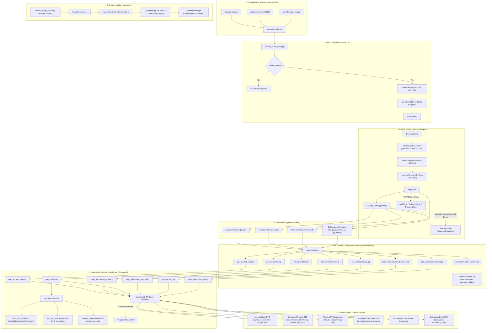

# LeetCode App & UserConfig Architecture

This document provides a comprehensive, self-contained guide to how the `leetcode` app and the supporting `userconfig` package work within this project.

---

## Table of Contents

1. [High-Level Overview](#1-high-level-overview)
2. [The `userconfig` Package](#2-the-userconfig-package)
   - [Why `userconfig` Exists](#why-userconfig-exists)
   - [File Storage & Locations (`paths.py`)](#file-storage--locations-pathspy)
   - [Safe Atomic File Operations (`files.py`)](#safe-atomic-file-operations-filespy)
   - [General Configuration (`schema.py` & `store.py`)](#general-configuration-schemapy--storepy)
   - [Credentials & Cookie Security (`credentials.py`)](#credentials--cookie-security-credentialspy)
   - [Effective Settings Resolution (`effective.py`)](#effective-settings-resolution-effectivepy)
   - [Error Handling (`errors.py`)](#error-handling-errorspy)
3. [The `leetcode` App Architecture](#3-the-leetcode-app-architecture)
   - [Layered Architecture Diagram](#layered-architecture-diagram)
   - [Exception Hierarchy (`exceptions.py`)](#exception-hierarchy-exceptionspy)
   - [Data Transfer Objects (`dto.py`)](#data-transfer-objects-dtopy)
   - [Transport Layer (`transport/`)](#transport-layer-transport)
   - [Resources Layer (`resources/`)](#resources-layer-resources)
   - [Mappers & Content Transformers (`mappers/`)](#mappers--content-transformers-mappers)
   - [Asset & Image Handling (`images.py`)](#asset--image-handling-imagespy)
   - [Client Facade (`client.py`)](#client-facade-clientpy)
   - [Client Lifecycle & Factory (`bootstrap.py`)](#client-lifecycle--factory-bootstrappy)
   - [Connection Health & Diagnostics (`connection.py`)](#connection-health--diagnostics-connectionpy)
4. [File-by-File Reference](#4-file-by-file-reference)
5. [Functionality & Connectivity Flowcharts](#5-functionality--connectivity-flowcharts)
   - [Master Architecture & Data Flow](#master-architecture--data-flow)
   - [How Components Connect & Interact](#how-components-connect--interact)

---

## 1. High-Level Overview

The `leetcode` app is an independent, specialized client library and ingestion engine for interacting with LeetCode. It encapsulates:

- **Authentication & Rate-Limiting**: Safe HTTP sessions using browser cookies (`LEETCODE_SESSION`, `csrftoken`), token-bucket pacing, jittered request spacing, and retries with exponential backoff.
- **Protocol Handling**: GraphQL queries and REST endpoint communications with LeetCode's backend.
- **Domain Modeling**: Strongly typed Pydantic Data Transfer Objects (DTOs) representing problems, submissions, account status, and tags.
- **Content Parsing**: Cleaning and converting raw question HTML into sanitized Markdown, plain text, and localized image URLs.
- **Asset Ingestion**: Reliable downloading and MIME-type detection of problem diagrams and images.

To configure credentials, rate limits, and output directories dynamically without hardcoded files, `leetcode` coordinates with the **`userconfig`** package.

---

## 2. The `userconfig` Package

The `userconfig/` package manages persistent user configuration and secrets outside of version control. It sits between user inputs, environment variables (`.env`), and the application components.

### Why `userconfig` Exists

1. **Separation of Secrets and Settings**: Keeps credentials (`secrets.json`) separate from regular settings (`config.json`).
2. **Crash-Resistant Storage**: Prevents corruption during sudden crashes, power outages, or restarts using atomic file replacements.
3. **Permissions Hardening**: Ensures credential files are strictly restricted to the OS file owner (`0o600`).
4. **Hierarchical Fallbacks**: Resolves settings dynamically: **Saved UI Settings** $\rightarrow$ **`.env` Variables** $\rightarrow$ **Built-in Defaults**.

---

### File Storage & Locations (`paths.py`)

All user configuration and credentials are saved in a designated data directory (default: `<PROJECT_ROOT>/data/`):

- `data_dir()`: Resolves the active data directory. Can be overridden using the `LEETNOTES_DATA_DIR` environment variable (useful for automated testing).
- `config_path()`: Points to `<data_dir>/config.json`.
- `secrets_path()`: Points to `<data_dir>/secrets.json`.
- `worker_lock_path()`: Points to `<data_dir>/worker.lock`.
- `ensure_data_dir()`: Creates the directory with restricted permissions (`0o700`) if it does not exist.

---

### Safe Atomic File Operations (`files.py`)

`write_text_atomic(path, text, mode=0o644)` writes data safely:

1. Opens a temporary file named `<file>.tmp` with the requested file mode.
2. Writes the text and flushes to disk.
3. Calls `os.replace()` to atomically swap the temporary file over the destination file.
4. **Benefit**: The destination file is never left half-written or corrupted if the program is interrupted mid-write.

---

### General Configuration (`schema.py` & `store.py`)

#### Schema (`schema.py`)

Defines `AppConfig` as a Pydantic model:

- `output_dirs`: Target folders (e.g., Obsidian vaults) where markdown notes are saved. Automatically deduplicated and trimmed.
- `leetcode_username`: The user's LeetCode handle.
- `time_zone`: The local time zone string (validated against Python's `zoneinfo.ZoneInfo`).
- `requests_per_second` & `requests_per_minute`: Client HTTP pacing constraints.
- `problems_per_minute`: Ingestion pace throttle.
- `default_provider` & `providers`: AI provider settings.
- Extra fields are ignored on load (`extra="ignore"`), maintaining backwards and forwards compatibility.

#### Storage (`store.py`)

- `load_config()`: Reads and validates `<data_dir>/config.json`. Returns a default `AppConfig()` if the file is missing.
- `save_config(config)`: Serializes `AppConfig` to formatted JSON and writes it atomically.
- `update_config(changes)`: Applies partial dictionary changes, validates the combined result, saves it, and returns the updated config. Raises `ConfigError` with clear field-level validation errors if invalid.

---

### Credentials & Cookie Security (`credentials.py`)

Manages the user's LeetCode browser session cookies:

- **Cookie Sanitization**: `clean_cookie_value()` automatically strips surrounding whitespace, quotes, trailing semicolons, and prefixes like `LEETCODE_SESSION=` or `csrftoken=` when pasted directly from browser devtools.
- **Model `LeetCodeCredentials`**:
  - Contains `session`, `csrf_token`, and `updated_at`.
  - Fields are marked `repr=False` and `hide_input_in_errors=True` so cookies are never printed in debug logs, error messages, or terminal tracebacks.
  - Property `is_complete`: Checks whether both session and CSRF tokens are present.
- **Permissions Tightening**: `tighten_permissions()` enforces `0o600` permissions (read/write only by the owner) on POSIX filesystems.
- **UI Masking (`CredentialsView`)**: `credentials_view()` returns a masked view (`session_hint`, `csrf_hint`) showing only the last 4 characters preceded by bullets (`••••••••abcd`) to verify configuration without exposing raw tokens.
- **Management Functions**:
  - `load_credentials()`: Loads and validates stored cookies.
  - `update_credentials(session=..., csrf_token=...)`: Updates passed cookies while preserving unpassed ones.
  - `clear_credentials()`: Securely removes the secrets file.

---

### Effective Settings Resolution (`effective.py`)

`userconfig.effective` provides unified getter functions used across the application. Each function implements the priority cascade:

1. Value from `data/config.json` or `data/secrets.json`.
2. Fallback to `django.conf.settings` (which reads from `.env`).

Key resolution functions:

- `output_dirs()`: Saved directories $\rightarrow$ `settings.NOTES_OUTPUT_DIRS`.
- `leetcode_username()`: Saved username $\rightarrow$ `settings.LEETCODE_USERNAME`.
- `requests_per_second()`: Saved rate $\rightarrow$ `settings.LEETCODE_REQUESTS_PER_SECOND`.
- `requests_per_minute()`: Saved rate $\rightarrow$ `settings.LEETCODE_REQUESTS_PER_MINUTE`.
- `problems_per_minute()`: Saved rate $\rightarrow$ `settings.LEETCODE_PROBLEMS_PER_MINUTE`.
- `leetcode_session()`: Saved session $\rightarrow$ `settings.LEETCODE_SESSION`.
- `leetcode_csrf_token()`: Saved CSRF token $\rightarrow$ `settings.LEETCODE_CSRF_TOKEN`.

---

### Error Handling (`errors.py`)

- `ConfigError`: Base exception raised when config files contain invalid JSON, failing validation rules, or malformed data.

---

## 3. The `leetcode` App Architecture

The `leetcode` app is structured in layers, separating raw HTTP transport, GraphQL queries, resource endpoints, data mappers, and the public client interface.

### Layered Architecture Diagram

```
┌─────────────────────────────────────────────────────────────┐
│                    LeetCodeClient (Facade)                  │
│       get_account_status(), get_problem(), etc.             │
└──────────────┬──────────────────────────────┬───────────────┘
               │                              │
     ┌─────────▼─────────┐          ┌─────────▼─────────┐
     │  Resources Layer  │          │   Mappers Layer   │
     │  AccountResource  │          │  map_account()    │
     │  ProblemsResource │ ───────> │  map_problem()    │
     │  SubmissionsRes.  │          │  html_to_markdown │
     └─────────┬─────────┘          └───────────────────┘
               │
     ┌─────────▼─────────┐
     │  Transport Layer  │
     │   GraphQLClient   │
     │    HttpClient     │
     │   JitteredAdapter │
     └─────────┬─────────┘
               │
     ┌─────────▼─────────┐
     │  LeetCode Server  │
     └───────────────────┘
```

---

### Exception Hierarchy (`exceptions.py`)

All exceptions derive from `LeetCodeError`:

```
LeetCodeError (Base)
├── TransportError       # Network timeout, connection failure, non-auth HTTP error (>=400)
├── AuthError            # HTTP 401/403: Expired, missing, or rejected cookies
├── RateLimitError       # HTTP 429: Exceeded request budget even after retries
├── NotFoundError        # Requested problem slug or submission ID does not exist
├── ResponseShapeError   # API response missing expected fields or malformed JSON
└── NotConfigured        # Cookies are completely unset in settings or .env
```

---

### Data Transfer Objects (`dto.py`)

All external data is modeled into immutable, typed Pydantic models:

- `AccountStatusDTO`: Sign-in state (`signed_in`), username, premium membership (`is_premium`).
- `TagDTO`: Topic tag name and slug (e.g., `{"name": "Dynamic Programming", "slug": "dynamic-programming"}`).
- `ProblemDTO`: Full problem metadata: `slug`, `leetcode_id`, `title`, `difficulty`, `category`, `tags`, and `raw_question_html`.
- `SubmissionSummaryDTO`: Brief submission record in list view: `id`, `status`, `lang`, `timestamp`.
- `RecentAcDTO`: Recent accepted submission: `slug`, `title`, `timestamp`.
- `SubmissionDetailDTO`: Full submission details: programming language (`lang`), source code (`code`), timestamp (`submission_date`).
- `DiscoveredProblemDTO`: Summary item from problem catalog: `slug`, `title`, `leetcode_id`, `difficulty`, `solved` (boolean), `paid_only` (boolean).

---

### Transport Layer (`transport/`)

The transport layer handles HTTP communication, headers, rate-limiting, and GraphQL abstraction.

#### 1. `session.py`

- `SessionConfig`: Dataclass holding cookie values, base URL, rate limits, timeout, max retries, and jitter parameters.
- `JitteredLimiterAdapter`: Subclasses `requests_ratelimiter.LimiterAdapter`.
  - Enforces rate limits (requests per second / per minute).
  - Automatically sleeps for a randomized jitter duration (default: `0.1s` to `0.6s`) before each request to break up bursts and simulate human traffic.
  - Ensures a default timeout (`30.0s`) on all outgoing requests.
- `create_session(config)`:
  - Mounts `JitteredLimiterAdapter` on `https://`.
  - Configures an automatic retry strategy using `urllib3.util.Retry` (retries HTTP 429, 500, 502, 503, 504 with exponential backoff). Retries apply to POST as well because queries are read-only.
  - Sets browser headers (`User-Agent`, `Referer`, `X-CSRFToken`, `Content-Type`).
  - Injects `LEETCODE_SESSION` and `csrftoken` cookies into the session cookie jar for `.leetcode.com`.
- `create_image_session(base_url)`:
  - Lightweight requests session tailored for downloading images (includes `Accept: image/*` headers).

#### 2. `http.py` (`HttpClient`)

- Wrapper around `requests.Session` handling URL composition and error translation:
  - Catches `requests.RequestException` $\rightarrow$ raises `TransportError`.
  - Status `401` or `403` $\rightarrow$ raises `AuthError`.
  - Status `429` $\rightarrow$ raises `RateLimitError`.
  - Status $\ge 400$ $\rightarrow$ raises `TransportError`.
  - Parses JSON response $\rightarrow$ raises `ResponseShapeError` if invalid JSON.
- Provides `get_json(path)` and `post_json(path, payload)`.

#### 3. `graphql.py` (`GraphQLClient`)

- Executes GraphQL requests against LeetCode's `/graphql` endpoint.
- Accepts `query` and optional `variables`.
- Inspects response payload:
  - If GraphQL returns top-level `errors` $\rightarrow$ logs warning and raises `LeetCodeError`.
  - If `data` is missing $\rightarrow$ raises `ResponseShapeError`.
  - Returns the inner `data` dictionary.

#### 4. `queries.py`

Contains the raw GraphQL query templates:

- `USER_STATUS_QUERY`: Queries `userStatus { isSignedIn, username, isPremium }`.
- `QUESTION_DETAILS_QUERY`: Queries problem metadata and HTML description by `titleSlug`.
- `SUBMISSION_LIST_QUERY`: Queries paginated submission history for a problem slug.
- `RECENT_AC_SUBMISSIONS_QUERY`: Queries recent accepted problems for a username.
- `SUBMISSION_DETAILS_QUERY`: Queries source code and execution stats for a submission ID.

---

### Resources Layer (`resources/`)

The resource classes organize API calls into domain-specific modules:

#### 1. `AccountResource` (`account.py`)

- `status()`: Calls `USER_STATUS_QUERY` and returns the raw `userStatus` dictionary.

#### 2. `ProblemsResource` (`problems.py`)

- `get(slug)`: Calls `QUESTION_DETAILS_QUERY`. Raises `NotFoundError` if the question does not exist. Returns the problem dictionary.
- `list_all()`: Calls LeetCode's REST endpoint `/api/problems/all/`. Returns raw stat-status pairs for every question on LeetCode (including solved status for the logged-in user).

#### 3. `SubmissionsResource` (`submissions.py`)

- `list_page(slug, limit=20, offset=0)`: Fetches a single page of submissions for a problem.
- `iter_all(slug, page_size=20)`: Generator yielding submissions across all pages until exhausted.
- `recent_accepted(username=None, limit=20)`: Fetches the most recent accepted submissions for the given (or default) user.
- `get_details(submission_id)`: Fetches full submission code and execution details. Raises `NotFoundError` if not found.

---

### Mappers & Content Transformers (`mappers/`)

Mappers convert raw API responses into clean DTOs and transform problem statements into usable formats.

#### 1. Base Builder (`base.py`)

- `build(model, **fields)`: Instantiates a Pydantic model with fields; catches `pydantic.ValidationError` and converts it into `ResponseShapeError`.

#### 2. Domain Mappers (`account.py`, `problem.py`, `submission.py`)

- `map_account_status(raw)`: Maps raw API dictionary to `AccountStatusDTO`.
- `map_problem(raw)`: Maps question details to `ProblemDTO`.
- `map_discovered_problem(raw)`: Maps catalog item to `DiscoveredProblemDTO`, resolving difficulty levels (`1: Easy`, `2: Medium`, `3: Hard`).
- `map_submission_summary(raw)`: Maps to `SubmissionSummaryDTO`.
- `map_recent_ac(raw)`: Maps to `RecentAcDTO`.
- `map_submission_detail(raw)`: Maps to `SubmissionDetailDTO`.

#### 3. Question Content Transformers (`mappers/question_content/`)

LeetCode statements are returned as raw HTML with embedded images, code blocks, and math tags. Three transformers process this HTML:

- **`html_to_markdown.py`**:
  - Unescapes HTML entities and non-breaking spaces.
  - Normalizes math markup (`<sub>` $\rightarrow$ `_text`, `<sup>` $\rightarrow$ `^text`).
  - Uses `LeetCodeMarkdownConverter` (custom `markdownify.MarkdownConverter`) to preserve indentation, format fenced code blocks, and prevent double-wrapped backticks.
  - Collapses redundant consecutive newlines.
- **`html_to_plain_text.py`**:
  - Converts HTML to clean plain text.
  - Preserves paragraph and block spacing for headings, tables, blockquotes, and lists.
  - Normalizes whitespace runs.
- **`images.py` (`rewrite_images`)**:
  - Parses HTML using BeautifulSoup.
  - Locates all `` tags.
  - Invokes a resolver callback `resolve(idx, src)`:
    - If `resolve` returns a string path, updates `img["src"]` to the new path.
    - If `resolve` returns `None` or image source is invalid, removes the `` tag cleanly.
  - Returns `(rewritten_html, total_img_count)`.

---

### Asset & Image Handling (`images.py`)

- `ImageDownloader`: Downloads image binaries over HTTP using an isolated session with specific image headers and a 10-second timeout.
- `_extension(url, content_type)`: Intelligently detects the file extension:
  1. Checks file extension in the URL path.
  2. Falls back to MIME type in `Content-Type` header (e.g., `image/jpeg` $\rightarrow$ `jpg`).
  3. Defaults to `png`.
- `DownloadedImage`: Dataclass returning `content: bytes` and `extension: str`.

---

### Client Facade (`client.py`)

`LeetCodeClient` is the public API entry point for the rest of the application. It delegates to the underlying resources and returns mapped DTOs:

- `get_account_status()` $\rightarrow$ `AccountStatusDTO`
- `get_problem(slug)` $\rightarrow$ `ProblemDTO`
- `list_all_problems()` $\rightarrow$ `list[DiscoveredProblemDTO]`
- `get_submissions(slug, limit=20, offset=0)` $\rightarrow$ `list[SubmissionSummaryDTO]`
- `iter_submissions(slug, page_size=20)` $\rightarrow$ `Iterator[SubmissionSummaryDTO]`
- `get_recent_accepted(username=None, limit=20)` $\rightarrow$ `list[RecentAcDTO]`
- `get_submission_details(submission_id)` $\rightarrow$ `SubmissionDetailDTO`

---

### Client Lifecycle & Factory (`bootstrap.py`)

Constructs and manages instances of `LeetCodeClient`:

- `ClientSettings`: Frozen dataclass capturing configuration parameters (`session`, `csrf_token`, `base_url`, `requests_per_second`, `requests_per_minute`, `username`). Cookies are masked in `repr`.
- `current_client_settings()`: Reads current values from `userconfig.effective`. Raises `NotConfigured` if either `session` or `csrf_token` is missing.
- `build_client(config)`: Assembles the entire pipeline (`requests.Session` $\rightarrow$ `HttpClient` $\rightarrow$ `GraphQLClient` $\rightarrow$ Resources $\rightarrow$ `LeetCodeClient`).
- `get_client()`: Thread-safe singleton client getter:
  - Uses `threading.Lock`.
  - Compares current settings against cached settings.
  - Reconstructs the client automatically if user credentials or rate limits change in `userconfig`.
- `reset_client()`: Clears cached client (primarily for testing).
- `get_image_downloader()`: Cached instance of `ImageDownloader`.

---

### Connection Health & Diagnostics (`connection.py`)

Provides a diagnostic health check verifying whether the user's saved LeetCode session is active and valid:

#### `ConnectionState` Enum

- `CONNECTED`: Cookies valid; authenticated successfully.
- `NOT_CONFIGURED`: Cookies have not been entered yet.
- `SIGNED_OUT`: Cookies expired or rejected by LeetCode.
- `RATE_LIMITED`: LeetCode is temporarily rejecting requests with HTTP 429.
- `UNREACHABLE`: Network error or LeetCode is down.
- `UNEXPECTED`: LeetCode responded with an unrecognized response shape.

#### `ConnectionResult`

Dataclass containing:

- `state`: The `ConnectionState`.
- `message`: User-friendly diagnostic message.
- `username`: Authenticated LeetCode username.
- `is_premium`: Premium status flag.
- `username_differs`: True if the saved username in config does not match the cookie owner.
- `ok`: Convenience boolean (`True` only when `CONNECTED`).

#### Checking Connection (`test_connection`)

- `test_connection(client=None)` calls `get_account_status()`:
  - If signed in: verifies whether `saved_username` matches `account.username` (warns if mismatched).
  - Handles `NotConfigured`, `AuthError`, `RateLimitError`, and `TransportError` gracefully, returning descriptive results rather than throwing uncaught exceptions.

---

## 4. File-by-File Reference

### `userconfig/`

| File                                                                                 | Purpose                                                                                 |
| ------------------------------------------------------------------------------------ | --------------------------------------------------------------------------------------- |
| [`paths.py`](file:///home/gajeet/Projects/leetnotes/userconfig/paths.py)             | Resolves directory paths for `data/`, `config.json`, `secrets.json`, and lock files.    |
| [`files.py`](file:///home/gajeet/Projects/leetnotes/userconfig/files.py)             | Provides `write_text_atomic` to write files safely via `.tmp` swap.                     |
| [`schema.py`](file:///home/gajeet/Projects/leetnotes/userconfig/schema.py)           | Pydantic model `AppConfig` defining non-secret user settings.                           |
| [`store.py`](file:///home/gajeet/Projects/leetnotes/userconfig/store.py)             | Loads, validates, saves, and updates `config.json`.                                     |
| [`credentials.py`](file:///home/gajeet/Projects/leetnotes/userconfig/credentials.py) | Manages LeetCode cookies in `secrets.json`, cleans inputs, enforces `0600` permissions. |
| [`effective.py`](file:///home/gajeet/Projects/leetnotes/userconfig/effective.py)     | Priority resolution: User settings $\rightarrow$ `.env` $\rightarrow$ Defaults.         |
| [`errors.py`](file:///home/gajeet/Projects/leetnotes/userconfig/errors.py)           | Defines `ConfigError`.                                                                  |

### `leetcode/`

| File                                                                                                                                               | Purpose                                                                              |
| -------------------------------------------------------------------------------------------------------------------------------------------------- | ------------------------------------------------------------------------------------ |
| [`client.py`](file:///home/gajeet/Projects/leetnotes/leetcode/client.py)                                                                           | Main `LeetCodeClient` facade exposing clean Python methods returning DTOs.           |
| [`bootstrap.py`](file:///home/gajeet/Projects/leetnotes/leetcode/bootstrap.py)                                                                     | Thread-safe singleton client builder and setting-change invalidator.                 |
| [`connection.py`](file:///home/gajeet/Projects/leetnotes/leetcode/connection.py)                                                                   | Health check testing cookie validity, username match, and network reachability.      |
| [`dto.py`](file:///home/gajeet/Projects/leetnotes/leetcode/dto.py)                                                                                 | Strongly typed Pydantic models for problems, submissions, accounts, and tags.        |
| [`exceptions.py`](file:///home/gajeet/Projects/leetnotes/leetcode/exceptions.py)                                                                   | Custom exception hierarchy rooted at `LeetCodeError`.                                |
| [`images.py`](file:///home/gajeet/Projects/leetnotes/leetcode/images.py)                                                                           | Image binary downloader with automatic extension and MIME detection.                 |
| [`transport/session.py`](file:///home/gajeet/Projects/leetnotes/leetcode/transport/session.py)                                                     | `requests.Session` factory with jitter, rate-limiting adapter, retries, and headers. |
| [`transport/http.py`](file:///home/gajeet/Projects/leetnotes/leetcode/transport/http.py)                                                           | Low-level JSON HTTP client translating status codes to exceptions.                   |
| [`transport/graphql.py`](file:///home/gajeet/Projects/leetnotes/leetcode/transport/graphql.py)                                                     | GraphQL client executing queries and validating response data.                       |
| [`transport/queries.py`](file:///home/gajeet/Projects/leetnotes/leetcode/transport/queries.py)                                                     | Raw GraphQL query strings for problems, submissions, and accounts.                   |
| [`resources/account.py`](file:///home/gajeet/Projects/leetnotes/leetcode/resources/account.py)                                                     | Account query resource.                                                              |
| [`resources/problems.py`](file:///home/gajeet/Projects/leetnotes/leetcode/resources/problems.py)                                                   | Problem details and full problem catalog query resources.                            |
| [`resources/submissions.py`](file:///home/gajeet/Projects/leetnotes/leetcode/resources/submissions.py)                                             | Submission listing, pagination, recent accepted, and code detail resources.          |
| [`mappers/base.py`](file:///home/gajeet/Projects/leetnotes/leetcode/mappers/base.py)                                                               | Generic DTO builder handling Pydantic validation errors.                             |
| [`mappers/account.py`](file:///home/gajeet/Projects/leetnotes/leetcode/mappers/account.py)                                                         | Transforms account GraphQL response to `AccountStatusDTO`.                           |
| [`mappers/problem.py`](file:///home/gajeet/Projects/leetnotes/leetcode/mappers/problem.py)                                                         | Transforms problem responses to `ProblemDTO` and `DiscoveredProblemDTO`.             |
| [`mappers/submission.py`](file:///home/gajeet/Projects/leetnotes/leetcode/mappers/submission.py)                                                   | Transforms submission history and details to DTOs.                                   |
| [`mappers/question_content/html_to_markdown.py`](file:///home/gajeet/Projects/leetnotes/leetcode/mappers/question_content/html_to_markdown.py)     | Converts problem HTML to clean, formatted Markdown.                                  |
| [`mappers/question_content/html_to_plain_text.py`](file:///home/gajeet/Projects/leetnotes/leetcode/mappers/question_content/html_to_plain_text.py) | Strips HTML into structured plain text.                                              |
| [`mappers/question_content/images.py`](file:///home/gajeet/Projects/leetnotes/leetcode/mappers/question_content/images.py)                         | Rewrites image URLs inside problem descriptions.                                     |

---

## 5. Functionality & Connectivity Flowcharts

This section details every capability provided by the `leetcode` app and diagrams how each component, resource, transport layer, mapper, and configuration setting connect with one another.

### How Components Connect & Interact

1. **Configuration & Credentials Flow**:
   - `userconfig.effective` reads user cookies (`LEETCODE_SESSION`, `csrftoken`), username, and pacing limits from `data/secrets.json` and `data/config.json` (falling back to `.env`).
   - `bootstrap.get_client()` builds a `ClientSettings` record. If cookies are missing, it raises `NotConfigured`.
   - `bootstrap` maintains a thread-safe singleton cache guarded by `threading.Lock`. If credentials or rate limits change, it rebuilds the client.

2. **Session & Transport Flow**:
   - `create_session(config)` sets browser headers and cookies, and mounts the `JitteredLimiterAdapter` on `https://`.
   - The adapter enforces rate limits (requests per second/minute), sleeps for a random jitter interval (`0.1s - 0.6s`) to evade anti-bot triggers, and applies an automatic retry strategy (`urllib3.Retry`) with exponential backoff on HTTP 429 and 5xx errors.
   - `HttpClient` wraps the session, executing requests and converting HTTP error codes into domain exceptions (`AuthError` on 401/403, `RateLimitError` on 429, `TransportError` on $\ge 400$).
   - `GraphQLClient` targets `/graphql`, injects queries and variables, inspects GraphQL response errors, and extracts the payload `data` object.

3. **Resources Layer Connection**:
   - `AccountResource`: Uses `GraphQLClient` to run `USER_STATUS_QUERY`.
   - `ProblemsResource`:
     - Uses `HttpClient` for the REST catalog at `/api/problems/all/`.
     - Uses `GraphQLClient` for question metadata via `QUESTION_DETAILS_QUERY`.
   - `SubmissionsResource`: Uses `GraphQLClient` for `SUBMISSION_LIST_QUERY` (paginated), `RECENT_AC_SUBMISSIONS_QUERY`, and `SUBMISSION_DETAILS_QUERY`.

4. **Client Facade (`LeetCodeClient`)**:
   - Acts as the single entry point holding references to `ProblemsResource`, `SubmissionsResource`, and `AccountResource`.
   - Dispatches calls to resources, then routes the raw dictionary responses through `leetcode.mappers` to instantiate typed Pydantic DTOs via `base.build()`.

5. **Connection Health Diagnostic (`connection.test_connection`)**:
   - Calls `client.get_account_status()`.
   - Evaluates whether the cookies are signed in and whether the authenticated account matches `userconfig.effective.leetcode_username()`.
   - Catches `NotConfigured`, `AuthError`, `RateLimitError`, and `TransportError`, returning a non-crashing `ConnectionResult` with descriptive UI messages.

6. **Content Transformation & Markdown Pipeline**:
   - `html_to_markdown`: Uses `LeetCodeMarkdownConverter` (BeautifulSoup + Markdownify) to convert question HTML into clean Markdown with code blocks and sub/superscript math syntax.
   - `html_to_plain_text`: Strips HTML into cleanly formatted plaintext, normalizing whitespace runs and block spacing.
   - `rewrite_images`: Scans HTML `` tags, applies a resolver callback to localize image paths, and strips broken images.

7. **Binary Image Downloader Pipeline**:
   - `get_image_downloader()` creates an isolated `requests.Session` with image-specific headers (`Accept: image/*`).
   - `ImageDownloader.download(url)` fetches raw binary content and deduces the file extension from the URL path, Content-Type header, or defaults to `.png`.

---

### Master Architecture & Data Flow



## Here is a step-by-step breakdown of how bootstrap.py works, why threading.Lock is needed, and how settings changes are detected.

──────

### 1. The Core Problem bootstrap.py Solves

In this application, we face two competing requirements:

1. Why we want a single shared client (Caching):
   • The LeetCodeClient contains an HTTP connection pool and a rate limiter (JitteredLimiterAdapter).
   • If every function created a brand-new client, each request would get a brand-new rate limiter with its own fresh token bucket.
   They wouldn't share the same pacing constraints, and concurrent requests would spam LeetCode and trigger HTTP 429 Too Many Requests.
   • Therefore, the client needs to be reused as a singleton.
2. Why a permanent singleton fails (Dynamic Configuration):
   • If a user opens the settings UI and updates expired cookies or changes their rate limits, a static singleton would stay stuck on
   the old credentials forever until the server restarts.
   • Therefore, the client must automatically rebuild itself whenever settings change.
   ──────

### 2. How userconfig is Loaded & Evaluated

Whenever get_client() is called, the very first line it runs is:
config = current_client_settings()
Let's look at what current_client_settings() does:
def current_client_settings() -> ClientSettings:
session = effective.leetcode_session()
csrf_token = effective.leetcode_csrf_token()
if not (session and csrf_token):
raise NotConfigured(NOT_CONFIGURED_MESSAGE)
return ClientSettings(
session=session,
csrf_token=csrf_token,
base_url=settings.LEETCODE_BASE_URL,
requests_per_second=effective.requests_per_second(),
requests_per_minute=effective.requests_per_minute(),
username=effective.leetcode_username(),
)

1. Hierarchy Resolution:
   • effective.leetcode_session() reads directly from data/secrets.json first. If empty, it falls back to .env (settings.
   LEETCODE_SESSION).
   • effective.requests_per_second() reads from data/config.json first, falling back to .env.
2. Snapshot Creation:
   • It captures this current state into a ClientSettings dataclass:
   @dataclass(frozen=True)
   class ClientSettings:
   session: str = field(repr=False)
   csrf_token: str = field(repr=False)
   base_url: str
   requests_per_second: float
   requests_per_minute: float
   username: str
   • Python dataclasses compare by value. If two ClientSettings objects have identical fields, config_A == config_B evaluates to True.
   If even a single cookie or rate-limit value changes, config_A == config_B evaluates to False.
   ──────

### 3. How Changes Are Detected & Applied

At the module level, two global variables track the cache:
_lock = threading.Lock()
_cached: tuple[ClientSettings, LeetCodeClient] | None = None

_cached holds a pair: (the_settings_it_was_built_with, the_client_instance).

Inside get_client():
def get_client() -> LeetCodeClient:
global _cached
config = current_client_settings()

        with _lock:
            if _cached is None or _cached[0] != config:
                _cached = (config, build_client(config))
            return _cached[1]

Here is the decision logic:

                      get_client() called
                              │
                config = current_client_settings()
                              │
                        Acquire _lock
                              │
                   ┌──────────┴──────────┐
                   ▼                     ▼
          _cached is None OR         _cached[0] == config
           _cached[0] != config        (Nothing changed)
                   │                             │
        Build brand-new client                   │
      _cached = (config, client)                 │
                   │                             │
                   └──────────┬──────────────────┘
                              ▼
                     Return _cached[1]

• Scenario A (Normal / Repeated Call):
• Settings have not changed.
• _cached[0] != config is False.
• It skips building anything and immediately returns the existing client (_cached[1]) with its shared connection pool and rate
limiter.
• Scenario B (User updated settings or cookies):
• The user pasted new cookies in the UI → saved to data/secrets.json.
• On the very next call, config contains the new cookie string.
• _cached[0] != config is True!
• It calls build_client(config), constructing a fresh requests.Session, HttpClient, and LeetCodeClient using the new cookies, and
replaces _cached.

──────

### 4. Why Do We Use threading.Lock?

Django processes requests across multiple threads (e.g., dashboard requests, background sync workers, API polling).

#### What would happen WITHOUT the lock? (Race Condition):

1. Thread 1 calls get_client(). It sees _cached is None and starts building the client (which takes a few milliseconds to configure
   headers, adapters, etc.).
2. At the exact same millisecond, Thread 2 calls get_client(). It also sees _cached is None!
3. Both Thread 1 and Thread 2 build separate client instances and write to _cached.
4. Now you have two separate rate limiters running at the same time, defeating the whole purpose of pacing requests.

#### How with _lock: fixes it:

• A threading.Lock acts like a single physical key to a room.
• When Thread 1 executes with _lock:, it takes the key.
• If Thread 2 arrives while Thread 1 is inside, it must pause and wait.
• Thread 1 builds the client, assigns _cached = (config, client), and exits the with block (releasing the key).
• Thread 2 now enters, checks if _cached is None or _cached[0] != config:, sees that _cached is already populated and matches config,
and immediately returns the client that Thread 1 just created!
────────────────────────────────────────────────────────────

> okay just a question we only use thread locks on the resource that is shared by the threads right? because in django apis we write lets
> say for a blog website we dont use thread locks for any of that matter, like its new to me seeing an acutal application of thread locks
> ▸ Thought for 11s
> Yes, exactly! Your intuition is 100% spot-on.
> You only use a threading.Lock when multiple threads are reading and modifying the same in-memory Python variable/object in the exact
> same process.

The reason you almost never see threading.Lock in a typical Django API (like a blog, e-commerce site, or CRUD app) comes down to how
Django is traditionally designed:
──────

### 1. Typical Django is "Shared-Nothing" (Stateless)

When you write a standard Django view: # A standard blog view
def create_comment(request, post_id):
post = Post.objects.get(id=post_id)
comment = Comment.objects.create(post=post, body=request.POST["body"])
return JsonResponse({"status": "ok"})
Notice what happens in memory:
• Every incoming request gets its own isolated thread.
• All the variables (post, comment, request) are local variables stored on that specific thread's stack.
• Once the response is sent, those variables are destroyed.
• No thread is touching another thread's Python variables. There is zero shared in-memory Python state!
──────

### 2. Who Handles Concurrency in Normal Django Apps?

In normal Django apps, concurrency is handled outside of Python's memory:

Where the Concurrency Lives │ How Django Handles It
─────────────────────────────┼──────────────────────────────────────────────────────────────────────────────────────────────────────────
The Database │ PostgreSQL/MySQL handles concurrency using ACID transactions and row-level locks (select_for_update()).
The Cache / Celery │ Redis or Memcached manages state and atomic counters (cache.incr()).
Worker Processes │ Production servers like Gunicorn or uWSGI run separate OS processes. Two processes don't share Python
│ memory at all (a threading.Lock wouldn't even work across different processes).
──────

### 3. Why This leetcode App Is Different

This project isn't just serving web pages—it acts like an active background client that talks to an external third-party API (LeetCode).

In this app, we have something that cannot live in the database:

1. A Global In-Memory Variable: # In leetcode/bootstrap.py
   _cached: tuple[ClientSettings, LeetCodeClient] | None = None
   _cached is a module-level global variable living directly in Python's heap memory.
2. A Stateful In-Memory Object:
   Inside _cached[1] is a requests.Session and a JitteredLimiterAdapter. That rate-limiter has an internal stopwatch and a token bucket
   counting "how many requests have we sent in the last 60 seconds?"
   • This rate-limiter cannot easily live in SQLite—it lives in Python RAM.
   • If multiple background worker threads in the same process tried to initialize or reset _cached at the same moment, they would
   stomp on each other's pointers.

──────

### Summary: The Golden Rule

• State in Database or Redis? → Use SQL transactions (transaction.atomic()), unique constraints, or Redis locks. Never use threading.
Lock.
• State in a global Python variable in RAM shared across threads? → That is the one place where threading.Lock is necessary.
