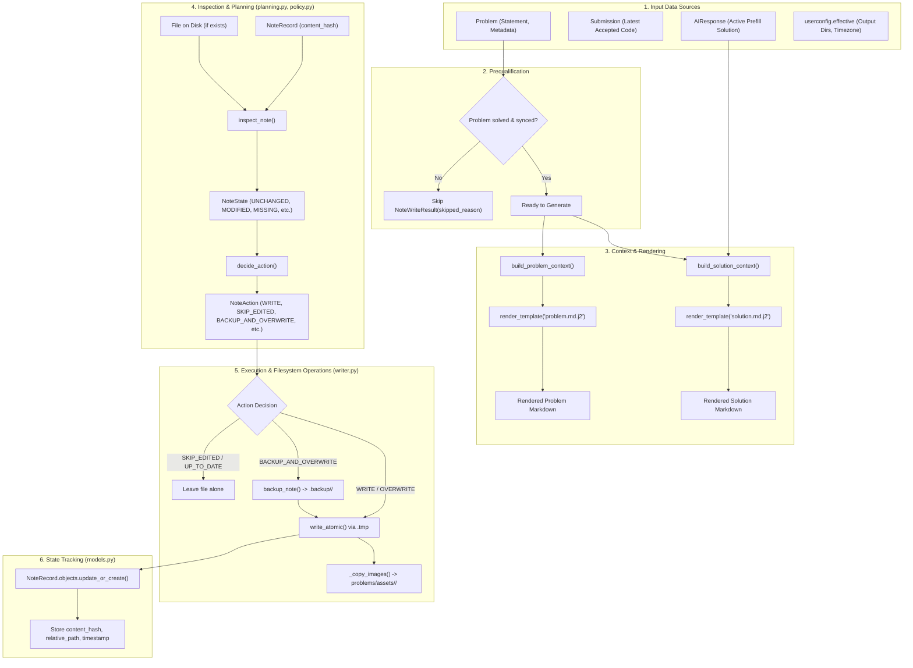

# Welcome to the Notes App! 📝

Hey there! Welcome to the team. As your mentor, I'm excited to walk you through the **`notes`** app. 

When you first hear about LeetNotes, the core idea sounds simple: *"Take solved LeetCode problems, ask an LLM to explain them, and save Markdown notes for Obsidian."*

In practice, syncing notes to someone's local filesystem—especially when they use tools like Obsidian, Syncthing, or iCloud Drive—is surprisingly tricky. If you're not careful, you can overwrite their handwritten notes, corrupt files during sudden laptop sleep or crashes, or mess up image paths.

The `notes` app is engineered to be **safe, non-destructive, and offline-first**. Let's break down how it works from the inside out!

---

## Table of Contents

1. [What Does the Notes App Do?](#1-what-does-the-notes-app-do)
2. [The Two Notes Per Problem](#2-the-two-notes-per-problem)
3. [The Vault Layout on Disk](#3-the-vault-layout-on-disk)
4. [The 4 Core Engineering Safeguards](#4-the-4-core-engineering-safeguards)
   - [A. Detecting Edits via Content Hashes](#a-detecting-edits-via-content-hashes)
   - [B. Atomic File Writes](#b-atomic-file-writes)
   - [C. Timestamped Conflict Backups](#c-timestamped-conflict-backups)
   - [D. Offline Local Image Mirroring](#d-offline-local-image-mirroring)
5. [Step-by-Step Generation Pipeline](#5-step-by-step-generation-pipeline)
6. [State Machine & Overwrite Policy](#6-state-machine--overwrite-policy)
7. [Architecture & Flowchart](#7-architecture--flowchart)
8. [File-by-File Guide](#8-file-by-file-guide)
9. [CLI Usage (`generate_notes`)](#9-cli-usage-generate_notes)

---

## 1. What Does the Notes App Do?

The `notes` app is responsible for:
1. **Generating Problem Notes**: Clean Markdown files holding the official problem statement, tags, metadata, local diagrams, and your latest accepted code submission.
2. **Generating Solution Notes**: AI-drafted study notes holding the core intuition, mental models, algorithmic traps, time/space complexities, approach comparisons, and flashcards.
3. **Cross-Linking**: Creating bidirectional Obsidian `[[wiki-links]]` between the problem and its solution note.
4. **Vault Synchronization**: Writing notes to one or more user-configured Obsidian vaults (or folders), while tracking what was written in the database (`NoteRecord`).

---

## 2. The Two Notes Per Problem

For every problem you solve, we generate a linked pair of notes:

| Note Type | File Location | Purpose & Key Contents |
|---|---|---|
| **Problem Note** | `Leetcode/problems/0001-two-sum.md` | Problem specification, official LeetCode link, tags, difficulty, localized images, and your actual accepted solution code block. |
| **Solution Note** | `Leetcode/solutions/0001-two-sum-solution.md` | AI-curated study guide: problem summary, recognition clue, approach tradeoffs, time/space tables, takeaways, and flashcards. |

Both files feature YAML frontmatter (`id`, `slug`, `title`, `difficulty`, `tags`, etc.) for easy indexing by Obsidian Dataview or other Markdown tools.

---

## 3. The Vault Layout on Disk

When you configure an output directory (e.g., `~/Documents/ObsidianVault`), the app creates and manages the following structure:

```text
<Output Directory>/
└── Leetcode/
    ├── problems/
    │   ├── 0001-two-sum.md
    │   ├── 0015-3sum.md
    │   └── assets/
    │       └── 0011-container-with-most-water/
    │           └── 0.jpg
    ├── solutions/
    │   ├── 0001-two-sum-solution.md
    │   └── 0015-3sum-solution.md
    └── .backup/
        └── two-sum/
            └── 0001-two-sum-solution-20261031-143015.md
```

### Notice three key design choices:
1. **Padded Numbers (`0001-two-sum.md`)**: LeetCode IDs are zero-padded to 4 digits (`notes/naming.py`). That way, file trees sort problems in natural numerical order.
2. **Local Assets Directory**: Problem images live under `problems/assets/<slug>/`, so relative image links inside `0001-two-sum.md` work completely offline inside your vault.
3. **Hidden Backup Folder (`.backup/`)**: The backup folder starts with a dot (`.`), meaning Obsidian ignores it during search and graph indexing.

---

## 4. The 4 Core Engineering Safeguards

Here is where the engineering gets fun. When building desktop/sync apps that write to the filesystem, you have to protect user data from 4 major hazards:

### A. Detecting Edits via Content Hashes (`hashing.py`)
Suppose a user opens Obsidian and edits a solution note by adding their own bullet point. If our pipeline runs again, how do we know they edited it without diffing git?
- Whenever we write a note, we calculate its SHA-256 hash and save it in the database in a [`NoteRecord`](file:///home/gajeet/Projects/leetnotes/notes/models.py#L8-L43).
- Later, we hash the file currently on disk. If `file_hash != recorded_hash`, the user edited it!
- **Trivial Differences Ignored**: `normalize_note_text()` strips trailing whitespace and unifies Windows (`\r\n`) vs Unix (`\n`) newlines. An editor re-saving a file won't trigger a false positive edit.

### B. Atomic File Writes (`files.py`)
Writing directly to a target file (`open("note.md", "w")`) is dangerous. If the process crashes mid-write, or if Obsidian Sync reads the file while it's halfway written, the file is corrupted.
- `write_atomic(path, text)` writes to a sibling temporary file (`note.md.tmp`) first.
- Once written, it calls `os.replace(tmp, path)`. On POSIX and Windows filesystems, `replace` is atomic—the file either exists in its entirety or not at all.

### C. Timestamped Conflict Backups (`backup.py`)
If a user deliberately runs `--replace-edited`, we never delete their handwritten work.
- `backup_note()` copies the existing file to `Leetcode/.backup/<slug>/<note-name>-<timestamp>.md` *before* the new note is written.
- If two backups happen within the exact same second, `free_path()` appends `-2`, `-3` to prevent accidental clobbering.

### D. Offline Local Image Mirroring (`services.py`)
Problem statements often contain diagrams hosted on LeetCode's CDN. If you're on a flight or LeetCode changes their CDN URLs, notes would break.
- Before writing the problem note, `_copy_images()` copies every diagram from `media/assets/<slug>/` directly into the vault's `problems/assets/<slug>/`.
- If the image already exists on disk with matching file size, copying is skipped for speed.

---

## 5. Step-by-Step Generation Pipeline

Here is the exact journey of a note from database models to Markdown on disk:

```
1. Eligibility Check (skip_reason)
       │
2. Context Assembly (context.py)
       │
3. Jinja2 Template Rendering (rendering.py)
       │
4. State Inspection & Policy Planning (state.py + policy.py)
       │
5. Safe Execution & Image Sync (writer.py + backup.py)
       │
6. Database Record Tracking (NoteRecord in models.py)
```

### Step 1: Eligibility Check
A problem must pass strict requirements before we attempt to generate notes:
- Problem must be marked `solved = True`.
- Problem must have a `leetcode_id`.
- Sync tasks for `content`, `images`, and `submissions` must be `DONE`.
- An accepted submission must exist in the database.
- For solution notes: an active AI prefill response (`AIResponse.is_active = True`) must exist.

### Step 2: Context Assembly
`build_problem_context()` and `build_solution_context()` collect all data needed by templates into clean dictionaries:
- Language names are normalized for syntax highlighting (e.g., `python3` $\rightarrow$ `python`, `golang` $\rightarrow$ `go`).
- Timestamps are converted into the user's configured local timezone (`TIME_ZONE`).
- Stems for cross-links (`[[0001-two-sum-solution|Link]]`) are generated.

### Step 3: Jinja2 Rendering
Using `jinja2.Environment` with `StrictUndefined` (meaning any missing variable immediately raises an error instead of rendering a blank space), `problem.md.j2` and `solution.md.j2` are rendered in memory.

### Step 4: State Inspection & Policy Planning
Before touching the disk, `plan_write()` inspects the destination:
- Does the file exist?
- Does a `NoteRecord` exist in the database?
- Does the on-disk file match what we previously wrote?
- Does the newly rendered text match what is already on disk?

Based on this, `decide_action()` selects an exact policy action.

### Step 5 & 6: Execution & Recording
- If `action` is `WRITE` or `OVERWRITE`: writes atomically and creates/updates `NoteRecord`.
- If `action` is `BACKUP_AND_OVERWRITE`: creates a timestamped backup first, then writes atomically and updates `NoteRecord`.
- If `action` is `SKIP_EDITED` or `UP_TO_DATE`: leaves the file untouched.
- If `action` is `ADOPT`: file matches text; creates the `NoteRecord` to start tracking it.

---

## 6. State Machine & Overwrite Policy

The decision logic in `policy.decide_action` follows this matrix:

| Current On-Disk State (`NoteState`) | Does New Text Match File? | `--replace-edited` Flag | Chosen Action (`NoteAction`) | What Happens? |
|---|---|---|---|---|
| `NEVER_WRITTEN` | No | Any | `WRITE` | Writes new note to disk. |
| `MISSING` (file was deleted) | No | Any | `WRITE` | Re-creates the missing note. |
| `UNCHANGED` (unedited by user) | Yes | Any | `UP_TO_DATE` | Does nothing (already up to date). |
| `UNCHANGED` (unedited by user) | No (e.g. new submission) | Any | `OVERWRITE` | Refreshes the note with new content. |
| `MODIFIED` (user edited note) | Yes | Any | `ADOPT` | Starts tracking the note hash. |
| `MODIFIED` (user edited note) | No | `False` (default) | `SKIP_EDITED` | **Leaves your note alone!** |
| `MODIFIED` (user edited note) | No | `True` | `BACKUP_AND_OVERWRITE` | Copies old note to `.backup/`, then overwrites. |
| `UNTRACKED_FILE` (file exists, no DB record) | No | `False` (default) | `SKIP_EDITED` | Treats existing file as user-edited; protects it. |
| `UNTRACKED_FILE` | No | `True` | `BACKUP_AND_OVERWRITE` | Copies aside, then overwrites. |

---

## 7. Architecture & Flowchart

Here is the complete architectural flow showing how data moves through the `notes` app:




---

## 8. File-by-File Guide

Here is an index of every file in `notes/` and its role:

| Module / File | Responsibility |
|---|---|
| [`models.py`](file:///home/gajeet/Projects/leetnotes/notes/models.py) | Defines `NoteRecord` (tracks `problem`, `kind`, `output_dir`, `relative_path`, and `content_hash`). |
| [`layout.py`](file:///home/gajeet/Projects/leetnotes/notes/layout.py) | Defines the directory layout (`Leetcode/problems/`, `Leetcode/solutions/`, `Leetcode/.backup/`). |
| [`naming.py`](file:///home/gajeet/Projects/leetnotes/notes/naming.py) | Generates padded filenames (`0001-two-sum.md`, `0001-two-sum-solution.md`). |
| [`hashing.py`](file:///home/gajeet/Projects/leetnotes/notes/hashing.py) | Computes normalized SHA-256 hashes ignoring whitespace/CRLF differences. |
| [`backup.py`](file:///home/gajeet/Projects/leetnotes/notes/backup.py) | Creates conflict backups with timestamps (`-20261031-153012.md`) and handles collisions. |
| [`files.py`](file:///home/gajeet/Projects/leetnotes/notes/files.py) | Provides `write_atomic()` (.tmp swap) and `has_content()` (checks for non-blank files). |
| [`context.py`](file:///home/gajeet/Projects/leetnotes/notes/context.py) | Maps `Problem`, `Submission`, and `SolutionNote` into template variables and cross-link stems. |
| [`rendering.py`](file:///home/gajeet/Projects/leetnotes/notes/rendering.py) | Configures Jinja2 environment, filters (`code_lang`, `localtime`), and renders templates. |
| [`state.py`](file:///home/gajeet/Projects/leetnotes/notes/state.py) | Inspects on-disk notes vs `NoteRecord` and classifies `NoteState`. |
| [`policy.py`](file:///home/gajeet/Projects/leetnotes/notes/policy.py) | State machine deciding `NoteAction` based on state and user flags. |
| [`planning.py`](file:///home/gajeet/Projects/leetnotes/notes/planning.py) | Combines state inspection and policy into a `WritePlan`. |
| [`writer.py`](file:///home/gajeet/Projects/leetnotes/notes/writer.py) | Executes `WritePlan`: coordinates backups, atomic writes, image copying, and record updates. |
| [`services.py`](file:///home/gajeet/Projects/leetnotes/notes/services.py) | Entry point for problem notes: handles prerequisites check and image preparation. |
| [`solution_notes.py`](file:///home/gajeet/Projects/leetnotes/notes/solution_notes.py) | Entry point for solution notes: checks active AI prefill responses. |
| [`generation.py`](file:///home/gajeet/Projects/leetnotes/notes/generation.py) | High-level orchestrator generating both notes and aggregating batch run totals. |
| [`management/commands/generate_notes.py`](file:///home/gajeet/Projects/leetnotes/notes/management/commands/generate_notes.py) | CLI management command exposing note generation to users. |

---

## 9. CLI Usage (`generate_notes`)

You can generate notes directly using the Django management command:

```bash
# Generate notes for all solved problems across your configured output directories
python manage.py generate_notes

# Generate notes for a specific problem by slug
python manage.py generate_notes --slug two-sum

# Limit the run to the first 10 solved problems
python manage.py generate_notes --limit 10

# Write into a custom folder for this run only
python manage.py generate_notes --output ~/Desktop/TestVault

# Force replacement of notes you edited (automatically creates backups first!)
python manage.py generate_notes --slug two-sum --replace-edited
```

### Example Output
```text
[1/2] two-sum: problem note: written 1; solution note: written 1
[2/2] add-two-numbers: problem note: kept_edited 1; solution note: written 1
Done: 2 problem(s): written 3, kept_edited 1.
Notes you edited were left alone. To replace one (the old version is backed up first): generate_notes --slug <slug> --replace-edited
```

---

That's the entire `notes` app! Whenever you need to add a new template field or change vault formatting, check `context.py` and `note_templates/`. If you're working on filesystem sync safety, refer to `writer.py` and `policy.py`. Happy coding! 🚀
