# The `pipeline` app, explained end to end

This document explains everything the `pipeline` app does, how each part works, and why it is built the way it is. Diagrams use Mermaid, so view this file in something that renders it (Obsidian, GitHub, VS Code with a Mermaid extension).

---

okay I understood the working but the thing is I can't connect it in my brain how the codebase is wired, i just copy pasted mostly now I dont have a depth of knowledge of the pipline app only rest of the modules I understood, no issues.

now in order to understand I think the best way would be to re implement the pipeline app but you dont have to give me the code just mention the function names of files and I will just copy to another duplicate pipeline app, just for the knowledge how it was built up from the scratch and I could ask some quetsions if I couldn't understand something in the approach.
and yes dont worry about the test cases we dont need to understand those or copy dont mention about them at all, be a mentor and a tutor and help me built this whole pipline from scratch part by part 


## Table of contents

1. [The big picture](#1-the-big-picture)
2. [File map](#2-file-map)
3. [Data model](#3-data-model)
4. [The three state machines](#4-the-three-state-machines)
5. [Stages and the stage plan](#5-stages-and-the-stage-plan)
6. [Task settings (the snapshot)](#6-task-settings-the-snapshot)
7. [Eligibility and task creation](#7-eligibility-and-task-creation)
8. [Preview](#8-preview)
9. [The engine](#9-the-engine)
10. [Outcomes: how a stage talks to the engine](#10-outcomes-how-a-stage-talks-to-the-engine)
11. [Transitions](#11-transitions)
12. [Stage handlers](#12-stage-handlers)
13. [Pacing](#13-pacing)
14. [The worker, the lock and the manager (threading)](#14-the-worker-the-lock-and-the-manager-threading)
15. [Crash recovery](#15-crash-recovery)
16. [Control and actions](#16-control-and-actions)
17. [Summary and the `run_worker` command](#17-summary-and-the-run_worker-command)
18. [Paradigms used, and why](#18-paradigms-used-and-why)
19. [Full walkthroughs](#19-full-walkthroughs)
20. [How the tests are built](#20-how-the-tests-are-built)
21. [Limits and things to know](#21-limits-and-things-to-know)

---

## 1. The big picture

**The problem.** To produce notes for a solved LeetCode problem you must do several slow, failure-prone things in order: fetch the statement, fetch the images, fetch your accepted submission, ask an AI to draft a note, (optionally) let you review it, and write two Markdown files. You want to do this for dozens of problems, leave it running, stop it any time, and have it carry on afterwards.

**The solution.** A small **job system** built on the database:

- A **Task** is one run: a group of problems.
- Each problem in a task is a **TaskItem**.
- Each item has six **ItemStage** rows, one per pipeline stage.
- A **worker** (a background thread, or a terminal command) repeatedly picks the next queued item, runs its next pending stage, and records the result.
- Anything that needs you (a pasted AI reply, a review approval) puts the item in a **waiting** state. The worker moves on to other items.
- Everything is saved in the database after every step, so a crash or Ctrl+C loses nothing.

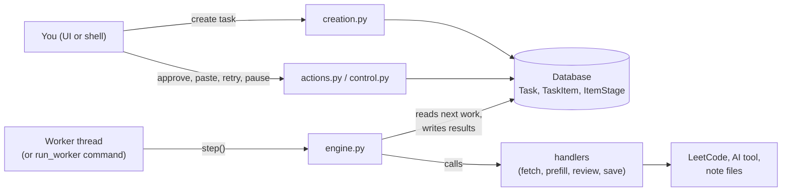

The key idea: **the database is the queue and the source of truth**. Nothing important lives only in memory.

---

## 2. File map

| File | Role |
|---|---|
| `models.py` | `Task`, `TaskItem`, `ItemStage` tables |
| `stages.py` | The `Stage` enum and the order of stages |
| `task_settings.py` | `TaskSettings` (per-run options) and how defaults and overrides merge |
| `eligibility.py` | Which problems may join a task, and why others cannot |
| `stage_plan.py` | For one problem, which stages start already skipped |
| `creation.py` | `create_task()`: builds the Task, items and stage rows |
| `preview.py` | "What would this task do?" without creating it |
| `outcomes.py` | `StageOutcome`, `StageError`, `PauseTask` |
| `handlers.py` | Fetch stage handlers and `StageDeps` |
| `note_handlers.py` | Prefill, review and save-notes handlers |
| `stage_registry.py` | Maps each `Stage` to its handler function |
| `transitions.py` | Every status change, as small named functions |
| `engine.py` | `step()` and `run_until_idle()`: runs one stage at a time |
| `pacing.py` | `Pacer`: spaces out LeetCode fetching |
| `locking.py` | `FileLock`: one-holder lock that survives crashes |
| `recovery.py` | Fixes half-finished work after an interruption |
| `worker.py` | `Worker`, `WorkerManager`, the background thread |
| `control.py` | start, pause, resume, cancel a task |
| `actions.py` | approve, reject, paste a reply, retry a failed item |
| `summary.py` | Plain-text task summaries |
| `management/commands/run_worker.py` | Run the worker in a terminal |

Dependency direction (arrows mean "imports"):

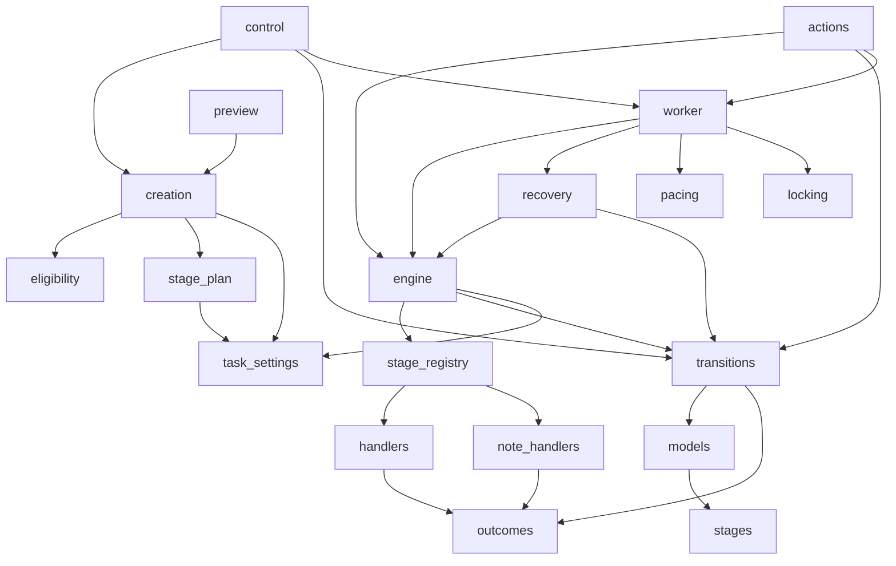

`transitions.py` and the handlers never import the engine, so the layers do not form a loop.

---

## 3. Data model

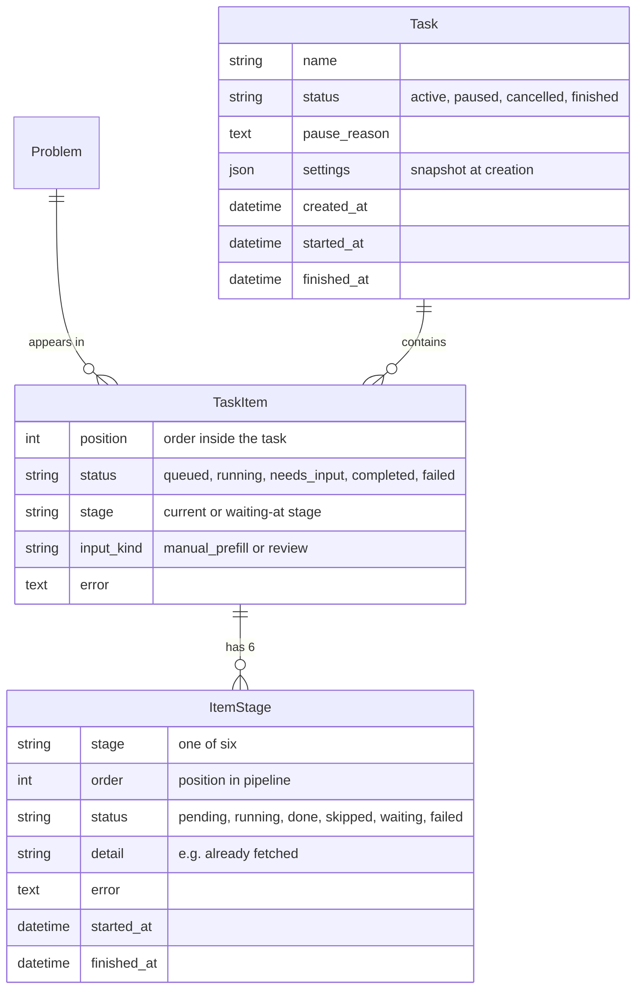

**Constraints (they protect you from bugs):**

- `one_item_per_problem_per_task`: a problem appears once per task.
- `one_row_per_stage_per_item`: each stage exists once per item.

**Why three tables instead of one?**

- `Task` is the whole run (pause or cancel it as a unit).
- `TaskItem` is per problem, so one problem failing does not stop the others.
- `ItemStage` is per stage, giving a timeline per problem ("fetch problem: done, fetch images: skipped because already fetched, review: waiting"). It also makes resuming exact: the next stage to run is simply the first `PENDING` row.

**`TaskItem.stage`** is a convenience pointer showing "where is this item now" (used for the "working on" column). The truth of what remains is in the `ItemStage` rows.

---

## 4. The three state machines

Every status change in the app goes through functions in `transitions.py`. There are three small state machines.

### 4.1 Task

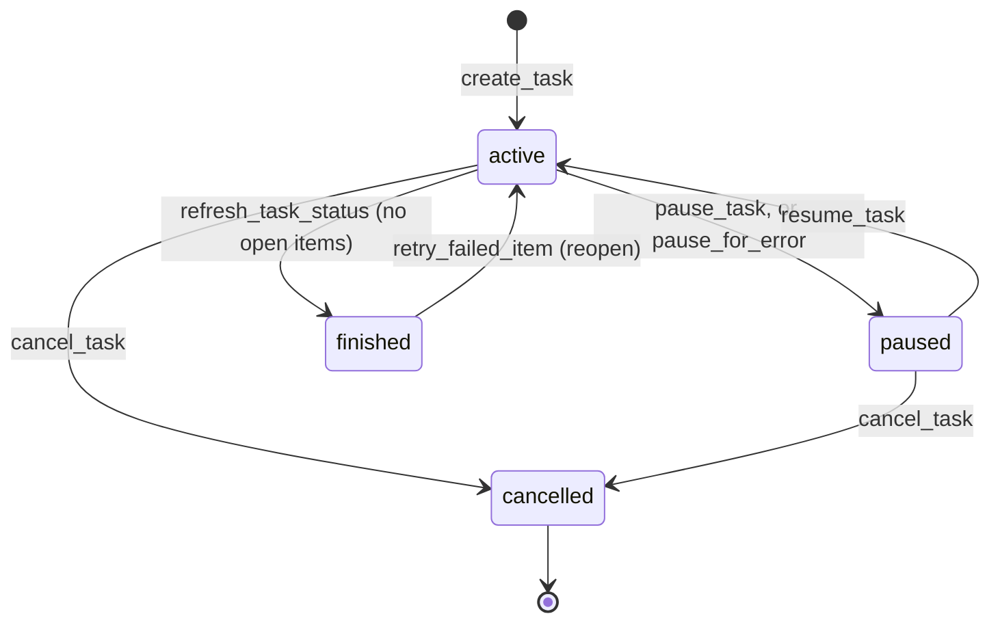

- Only an **active** task is picked up by the worker.
- **Paused** can be by you ("Paused by you") or automatic (cookies expired, bad provider, no output folder). The reason is stored in `pause_reason`.
- A task **finishes** when no item is queued, running or waiting (`task_is_done`). Items that are completed *or failed* count as finished.
- A cancelled task frees its problems for other tasks.

### 4.2 TaskItem

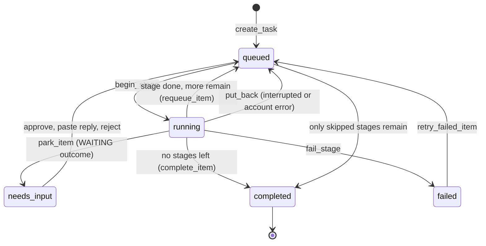

### 4.3 ItemStage

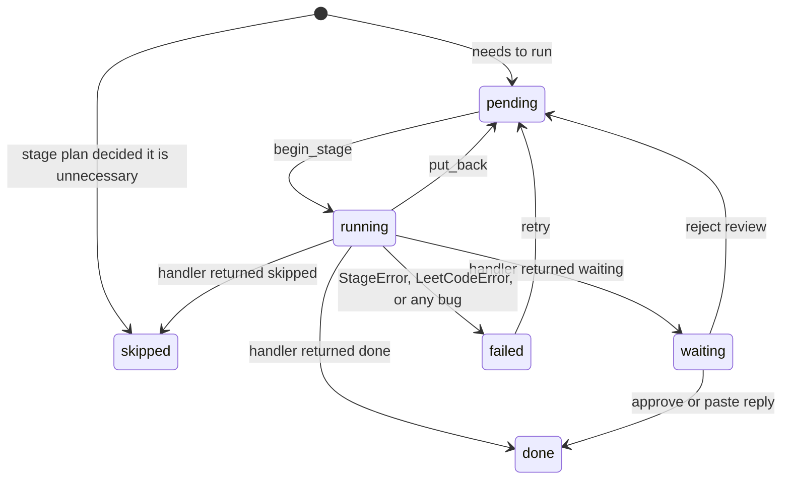

A key design choice: **a stage that "could not really run" goes back to `pending`, not `failed`.** That applies to account-level problems (expired cookies, rate limits) and to interruptions. Nothing is wrong with that problem, so it must not be marked as broken.

---

## 5. Stages and the stage plan

### 5.1 The six stages

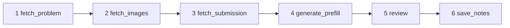

`stages.py` defines them with `models.TextChoices`. `STAGE_ORDER` is the tuple of all stages in order, and helpers `stage_order()` and `next_stage()` convert between names and positions. Each stage has a human label, used in the "working on" text.

### 5.2 Why a "stage plan"?

If a problem was synced before, re-fetching it wastes LeetCode requests. If it already has an up-to-date AI note, calling the AI again wastes time. The plan decides, **at creation time**, which stages start `skipped` and records a short reason in `detail`.

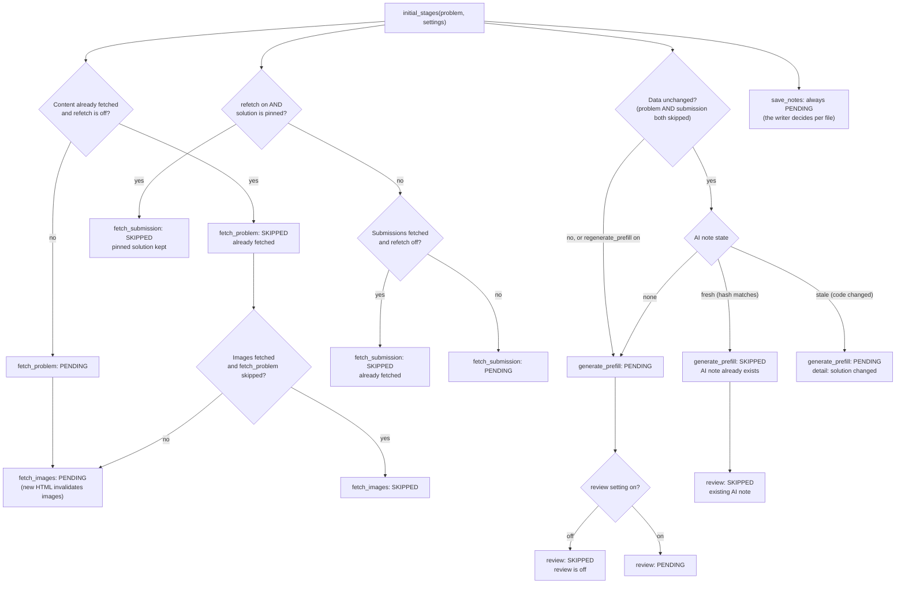

**Freshness of an AI note.** `ai_note_state()` rebuilds the prompt and compares `prompt.input_hash` with the hash stored on the active `AIResponse`. The hash covers the statement, language and code. If they differ the note is `STALE`; with no active note it is `NONE`; otherwise `FRESH`. If the prompt cannot be built (data missing), the note counts as `STALE`.

**`first_open_stage()`** (in `creation.py`) finds the first non-skipped stage so the item starts there. Because the engine only looks for `PENDING` rows, skipped stages are bypassed automatically.

---

## 6. Task settings (the snapshot)

`TaskSettings` is a Pydantic model:

| Setting | Default | Meaning |
|---|---|---|
| `provider` | `manual` (overridden by your saved default) | An AI provider name, or `manual` (you paste a reply) |
| `review` | from your config (`review_before_writing`) | Wait for approval before saving notes |
| `output_dirs` | from config or `.env` | Where notes are written |
| `replace_edited` | `False` | Replace notes you edited (backed up first) |
| `refetch` | `False` | Fetch again even if the data exists |
| `regenerate_prefill` | `False` | Ask the AI again even if a fresh note exists |
| `manual_fallback` | `True` | If the AI tool fails, ask you to paste instead |

### The snapshot pattern

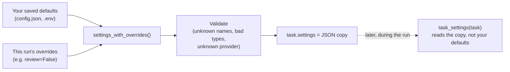

**Why snapshot?** Imagine a task with 100 problems running for an hour. You open Settings and turn review off. Without a snapshot, the running task would suddenly change behaviour half way. With the snapshot, a task keeps the settings it was created with. `extra="ignore"` means old snapshots saved by an older version still load.

**Validation** catches mistakes early: a misspelled setting name raises `TaskSettingsError` (`check_override_names`), a bad type is reported by Pydantic, and an unknown provider lists the valid choices.

---

## 7. Eligibility and task creation

### 7.1 Who can join a task

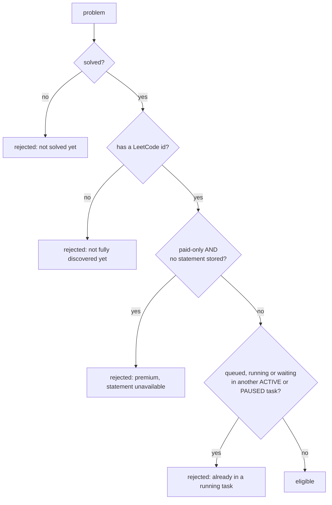

`busy_problem_ids()` finds busy problems with **one query** for the whole batch, rather than one query per problem. Cancelled and finished tasks do not block, so cancelling a task frees its problems.

### 7.2 Creating the task

`create_task()` is wrapped in `@transaction.atomic`: either the whole task (task row, item rows, stage rows) is created, or nothing is.

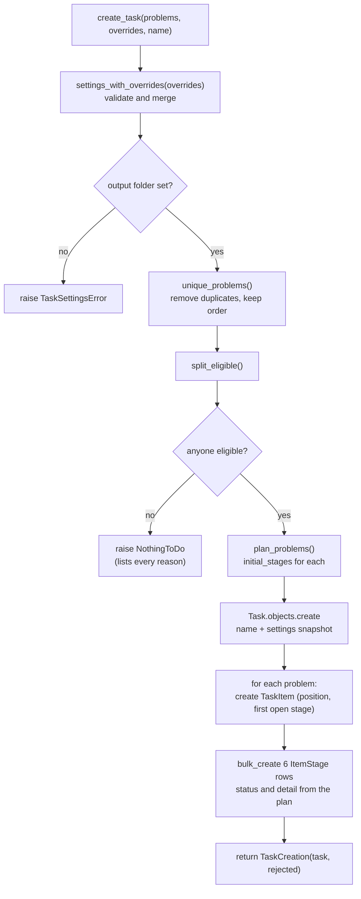

Rejected problems are **returned, not raised**, so a UI can say "3 added, 1 skipped (not solved yet)".

---

## 8. Preview

`preview_plan(problems, overrides)` answers "what would happen if I created this task?" **without creating anything**.

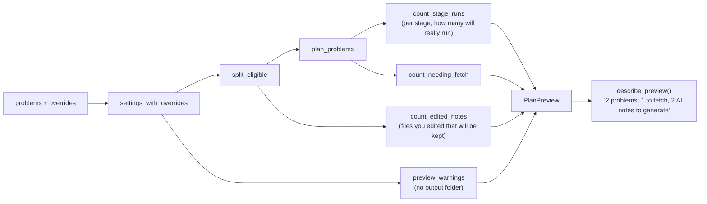

It reuses the same planning code as real creation, so the preview cannot drift from what actually happens. Edited notes are counted by inspecting each note file against its record (`inspect_note`). If `replace_edited` is on, the count is zero, because they will be replaced.

---

## 9. The engine

The engine is a loop that does **one stage of one item at a time**. It contains no knowledge about LeetCode or AI; it only knows how to pick work, call a handler, and record what happened.

### 9.1 Choosing work

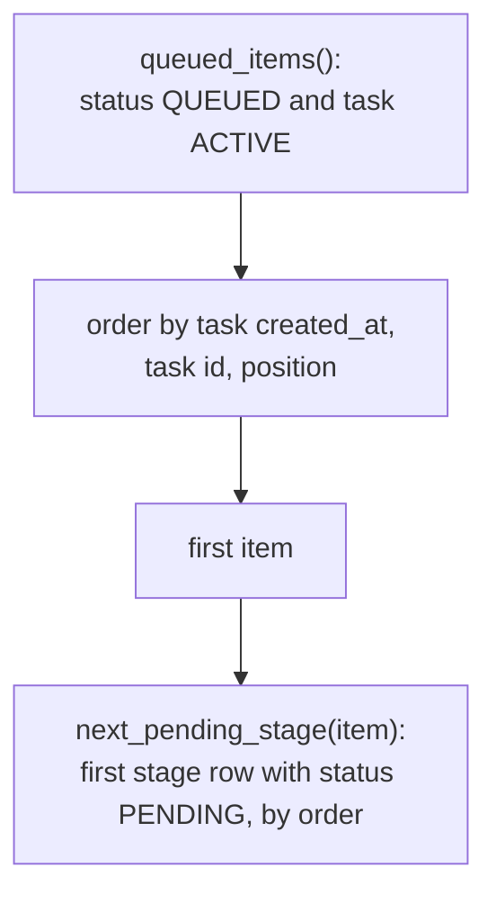

So: **oldest task first, then position within the task**. Paused, cancelled and waiting items are never chosen.

### 9.2 `step()`

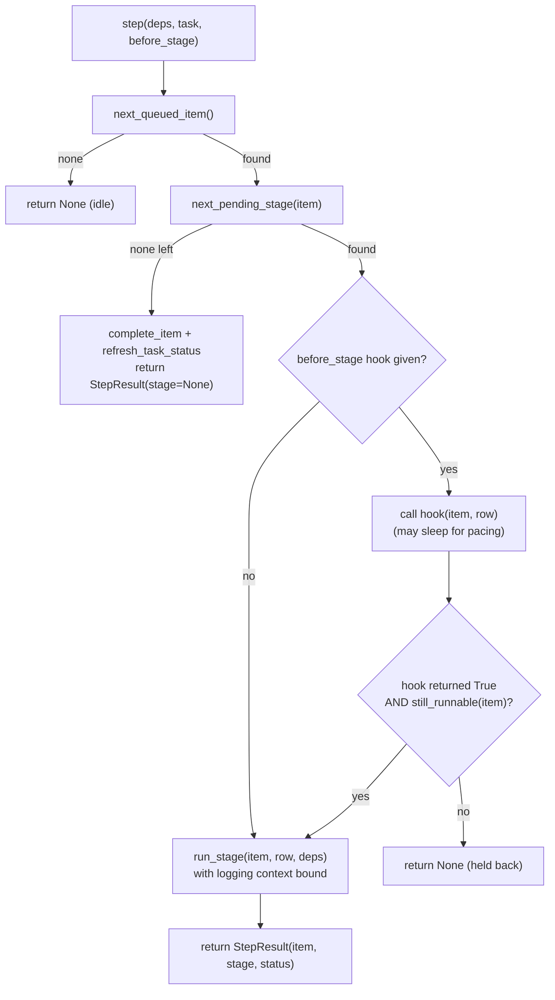

`still_runnable()` reloads the item and task status from the database. The hook can take a long time (pacing may sleep for seconds), and during that sleep you might pause or cancel the task. Without this re-check the engine would run a stage on a paused task.

### 9.3 `run_stage()` and how errors are classified

This is the heart of the engine. The exception type decides what happens.

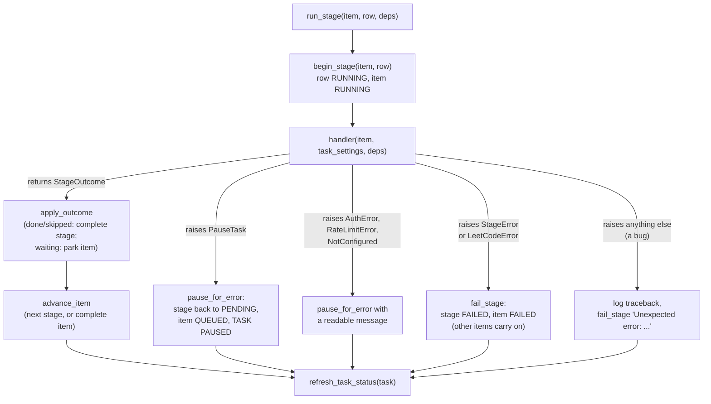

The rule in one sentence: **if the problem is with this one LeetCode problem, fail that item; if it affects everything, pause the whole task; if it is a bug, fail the item but keep the engine alive.**

| Situation | Example | Result |
|---|---|---|
| Problem-specific | Problem deleted on LeetCode (`NotFoundError`), network timeout (`TransportError`) | Item fails, others continue |
| Account-level | Cookies expired (`AuthError`), `429` (`RateLimitError`), no cookies (`NotConfigured`) | Task pauses, stage goes back to pending |
| Config-level | Bad AI provider setting, no output folder (`PauseTask`) | Task pauses |
| Bug | `RuntimeError` inside a handler | Item fails with the message; engine keeps running |

### 9.4 `run_until_idle()`

Calls `step()` in a loop until it returns `None` or `max_steps` (10,000, a safety limit) is reached. Used mainly by tests and by anything that wants "run everything now" synchronously. The real worker has its own loop with sleeping and crash handling (section 14).

---

## 10. Outcomes: how a stage talks to the engine

A handler communicates through **return values and exceptions**, never by touching statuses itself.

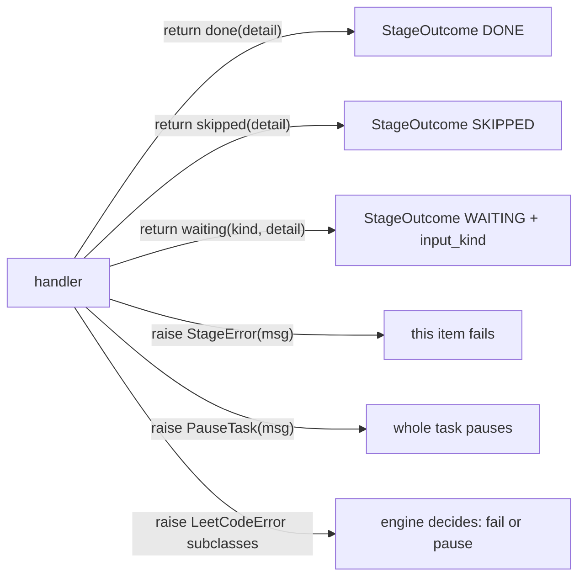

`StageOutcome` is a **frozen dataclass** (immutable value object). `detail` is clipped to 300 characters (`clip()`) to fit the database column, so a long message can never crash the save.

**Why this matters:** handlers stay simple and testable ("given this input, returns done"), and all status bookkeeping lives in one place.

---

## 11. Transitions

`transitions.py` contains **no business logic and does no work**. It only changes statuses. Each function has a name describing the event.

| Function | What it does |
|---|---|
| `save_fields(obj, **values)` | Set fields and save *only those* (plus `updated_at` if present). Avoids overwriting other columns |
| `begin_stage` | Row to RUNNING, item to RUNNING with `stage` set, sets start times once |
| `complete_stage` | Row to DONE or SKIPPED with detail and finish time |
| `park_item` | Row to WAITING, item to NEEDS_INPUT with `input_kind` |
| `apply_outcome` | Routes WAITING to `park_item`, otherwise to `complete_stage` |
| `fail_stage` | Row FAILED and item FAILED, both with the error |
| `put_back` | Row to PENDING (times cleared), item to QUEUED: "it did not really run" |
| `complete_item` | Item COMPLETED, `input_kind` cleared |
| `requeue_item` | Item QUEUED pointing at the next stage |
| `pause_for_error` | `put_back` plus pause the task with a reason |
| `pause_task` / `resume_task` / `cancel_task` | Task status changes, each guarded (only valid from the right status) |
| `task_is_done` | No item left queued, running or waiting |
| `refresh_task_status` | If task is ACTIVE and done, mark it FINISHED |

**Guards matter.** `pause_task` does nothing unless the task is ACTIVE; `resume_task` does nothing unless it is PAUSED; `cancel_task` ignores finished tasks. So `pause_for_error` cannot "un-cancel" a task you cancelled while a stage was running. That is tested explicitly.

---

## 12. Stage handlers

All handlers have the same signature: `(item, settings, deps) -> StageOutcome`. They are registered in `stage_registry.HANDLERS`, a dictionary from `Stage` to function.

### 12.1 Dependency bundle: `StageDeps`

```python
@dataclass(frozen=True)
class StageDeps:
    get_client:     Callable[[], LeetCodeClient]
    get_downloader: Callable[[], ImageDownloader]
    get_provider:   Callable[[str], Provider]
```

It holds *factories* for the outside world. Production uses the real ones; tests pass fakes. Because they are callables, the real LeetCode client is only built when a stage actually needs it (so a task with everything cached does not require cookies).

### 12.2 Fetch stages

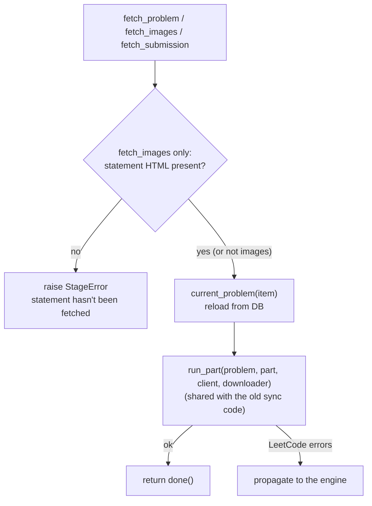

- `current_problem()` **reloads from the database** on every stage so a stage sees what earlier stages saved (title, HTML, and so on).
- `run_part` is the same function used by the admin sync. It always runs, even if already done, because the plan decided the stage should run. For account-level errors it re-raises without marking the problem failed; for others it marks the `SyncTask` failed and raises.
- The handler **does not catch LeetCode errors**; classification is the engine's job.

### 12.3 `generate_prefill`

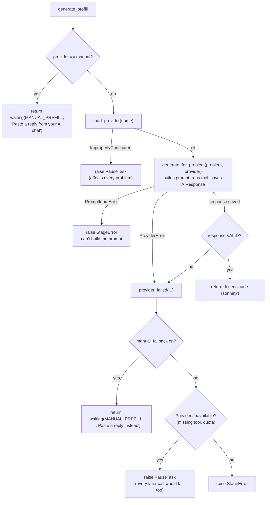

Important distinction between the two provider exceptions:

- `ProviderError`: *this one generation* failed (timeout, bad exit code). Other problems may be fine.
- `ProviderUnavailable` (subclass): the tool is missing, logged out, or out of quota. **Every later call would fail**, so (without fallback) the whole task pauses.

An invalid JSON reply is still **stored** as an `AIResponse` with status `invalid` (useful to inspect), but is never activated.

### 12.4 `review`

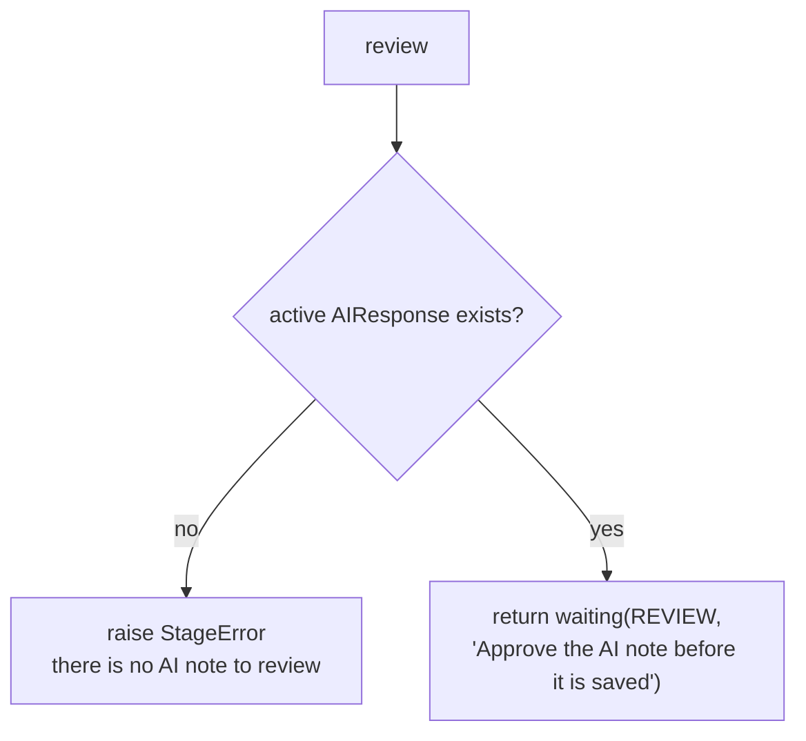

The handler only *parks* the item. The approval itself is an action (section 16) that marks this stage done.

### 12.5 `save_notes`

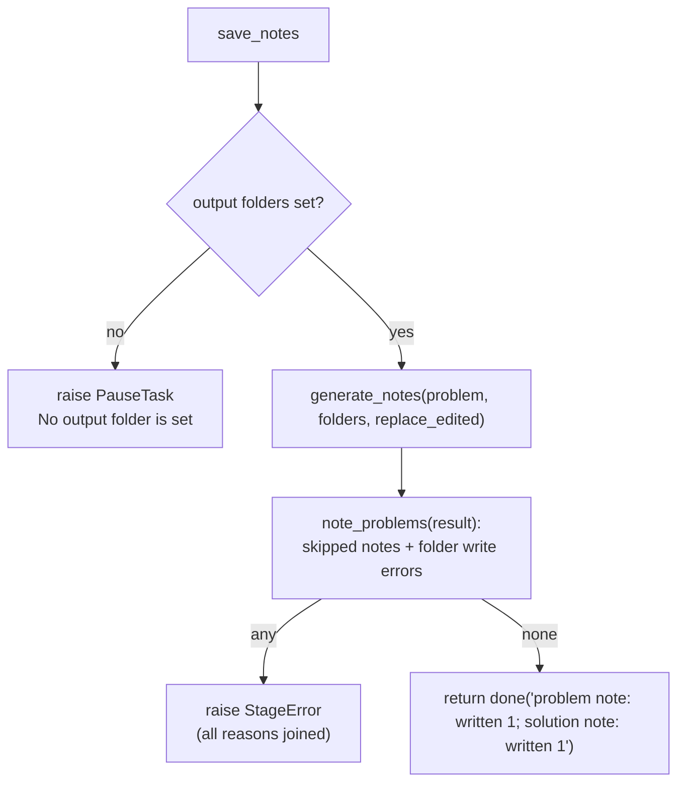

"Edited and kept" is **not** an error: the note simply stays as you edited it and is reported in the detail text.

---

## 13. Pacing

**Problem.** Fetching many problems quickly hammers LeetCode and risks rate limiting or a ban. The old `sync_all` used batches and long pauses. The pipeline needs the same politeness, but without freezing the engine.

**Approach.** A `Pacer` object plugged into the engine through the `before_stage` hook. It makes the **start of fetching a new problem** wait until at least one interval has passed since the *previous problem's fetching started*.

```mermaid
flowchart TD
    A["before_stage(item, row)"] --> B{"stage is one of the 3 fetch stages?"}
    B -->|no| T1["return True (never paced)"]
    B -->|yes| C{"same item as last time?"}
    C -->|yes| T2["return True<br/>(later fetch stages of the same problem don't wait)"]
    C -->|no| D["take_turn(item.pk)"]
    D --> E["gap = 60 / problems_per_minute"]
    E --> F{"gap set AND a previous start exists?"}
    F -->|no| CLAIM
    F -->|yes| G["remaining = last_start + gap + jitter - now"]
    G --> H{"remaining > 0?"}
    H -->|no| CLAIM
    H -->|yes| I["wait(remaining)"]
    I --> J{"worker told to stop while waiting?"}
    J -->|yes| FALSE["return False<br/>(turn NOT claimed; engine holds back)"]
    J -->|no| CLAIM["claim turn:<br/>last_item = this, last_start = now<br/>return True"]
```

Details:

- **Jitter** adds up to 20% random extra delay so requests are not perfectly rhythmic (looks less robotic).
- **Time already passed counts.** If generating an AI note took 40 seconds, no more waiting is needed.
- The pace comes from `effective.problems_per_minute()` (saved setting first, then `.env`). With no pace, no waiting.
- AI and note stages are **never paced**; they do not touch LeetCode.
- If the worker is stopped during the wait, `wait()` returns `False`, the turn is **not** claimed, and the engine returns without running anything. The stage stays pending for next time.
- The clock, the waiting function and the jitter are all **injected**, so tests use a fake clock and run instantly.

---

## 14. The worker, the lock and the manager (threading)

This is the part that uses multithreading and OS-level locking.

### 14.1 Why a background worker at all?

A web request must answer in well under a second. A task takes minutes (fetching, a one-minute AI call, pacing sleeps). So the work must run **outside the request**. Options:

| Option | Verdict for this project |
|---|---|
| Do it inside the request | Browser would hang, time out |
| Celery + Redis | Heavy: extra services for a single-user local app |
| `asyncio` | Our work is blocking (subprocess calls, `requests`, Django ORM); async would not help and Django's ORM is sync |
| `multiprocessing` | More machinery than needed; DB connections and state sharing get complicated |
| **One background thread** | Simple, shares the process, and the work is I/O-bound so the GIL is not a problem |

We chose **one daemon thread** plus a **database-backed queue**.

### 14.2 The `Worker` class

```mermaid
flowchart TD
    A["Worker.run()"] --> B{"lock.acquire()"}
    B -->|"False (someone else works)"| X["log, return False"]
    B -->|True| C["recover_leftovers()<br/>(section 15)"]
    C --> D["work_until_idle()"]
    D --> E["finally: lock.release()"]
    E --> F["return True"]
```

`work_until_idle()` is a loop:

```mermaid
flowchart TD
    L["loop while not stop_event.is_set()"] --> M["next_move()"]
    M -->|"raises Exception"| C1["crashes += 1, log traceback"]
    C1 --> C2{"crashes >= 5?"}
    C2 -->|yes| END["give up and return"]
    C2 -->|no| C3["wait(poll_seconds)"] --> L
    M -->|WORKED| W["idle_since = None"] --> L
    M -->|HELD| H["wait(0.1s)"] --> L
    M -->|IDLE| I["start idle timer if not started"]
    I --> J{"idle longer than idle_timeout?"}
    J -->|yes| END
    J -->|no| K["wait(poll_seconds = 2s)"] --> L
```

`next_move()` returns one of three **moves**:

- `WORKED`: a stage ran. Loop again immediately.
- `HELD`: `step()` returned nothing but there is still queued work (the pacer held it back, or the task was paused or changed meanwhile). Retry after 0.1 s.
- `IDLE`: nothing to do. Sleep 2 s, and exit after `idle_timeout` (default 60 s) so the thread does not live forever.

**Crash handling.** Handler bugs never reach here (the engine catches them). But a database error or similar inside `step()` itself would. The worker logs it, waits, and tries again, giving up after **5 crashes in a row** (`MAX_CRASHES`) so it can never spin forever. A successful move resets the counter.

### 14.2.1 The interruptible sleep (`threading.Event`)

```python
def wait(self, seconds):
    return not self.stop_event.wait(seconds)
```

`time.sleep(30)` cannot be cancelled. `Event.wait(30)` sleeps up to 30 s but **wakes immediately** if another thread calls `stop_event.set()`. It returns `True` if the event was set. We invert it so `wait()` returns `False` when told to stop. That is how Ctrl+C or "stop" interrupts even a long pacing sleep in under a moment.

`stop()` is **cooperative**: it sets the flag, and the worker finishes the stage it is in, then exits. We never kill a thread in the middle of a stage (that could leave half-written state).

### 14.3 `FileLock`: only one worker, ever

**Problem.** You could end up with two workers: the web server's thread *and* a `run_worker` terminal, or two server processes. Two workers would pick the same queued item and run the same stage twice (duplicate AI calls, double LeetCode requests, corrupted state).

**Why not a Python `threading.Lock`?** It only works inside one process. It cannot stop a second process.

**Why not a database flag ("worker_running = True")?** If the process is killed (power cut, `kill -9`), the flag stays `True` forever and nobody can start a worker. You would need a "stale lock" timeout guess.

**Solution: an OS file lock (`fcntl.flock`).**

```python
handle = open(path, "a+")
fcntl.flock(handle, fcntl.LOCK_EX | fcntl.LOCK_NB)   # exclusive, non-blocking
```

- `LOCK_EX`: exclusive; only one holder.
- `LOCK_NB`: do not wait; fail immediately if taken (raises `BlockingIOError`, which `acquire()` turns into `False`).
- **The operating system releases the lock automatically when the process dies**, even if killed. So a crash can never leave a stale lock.
- Each `FileLock` opens the file **itself**. `flock` locks belong to the open file description, so two `FileLock` objects on the same path exclude each other even **inside one process**. That is also why tests can simulate "another worker" in a single process.
- Linux and macOS only (the file says so).

```mermaid
sequenceDiagram
    participant W1 as Worker A (web thread)
    participant W2 as Worker B (run_worker command)
    participant OS as OS file lock (worker.lock)
    W1->>OS: flock(LOCK_EX | LOCK_NB)
    OS-->>W1: granted
    W2->>OS: flock(LOCK_EX | LOCK_NB)
    OS-->>W2: refused (BlockingIOError)
    W2-->>W2: acquire() returns False, run() returns False
    Note over W1: works...
    W1->>OS: unlock and close
    Note over OS: if W1's process had crashed,<br/>the OS would release it anyway
```

### 14.4 `WorkerManager`: one thread per web process

**Problem.** The UI will call "start this task" many times. We must start a worker thread only if none is running in this process, and we must not **miss work that arrives right as the worker is finishing**.

```python
class WorkerManager:
    _mutex   = threading.Lock()   # protects _worker
    _worker  = None               # the running Worker, or None
```

`ensure_running()`:

```mermaid
flowchart TD
    A["ensure_running()"] --> B["acquire mutex"]
    B --> C{"_worker already set?"}
    C -->|yes| R1["release, return False<br/>(one is running)"]
    C -->|no| D["_worker = make_worker()"]
    D --> E["release mutex"]
    E --> F["spawn daemon thread running _run(worker)"]
    F --> R2["return True"]
```

`_work_until_nothing_is_left()` is the subtle part:

```python
while True:
    owned = worker.run()
    with self._mutex:
        if not owned or worker.stop_event.is_set() or not has_queued_work():
            self._worker = None
            return
```

**The race it solves.** Imagine the worker has just decided it is idle and is about to exit. At that exact moment you click "start task". Two bad outcomes are possible:

1. `ensure_running()` sees `_worker` still set and does nothing, **and** the worker then exits. The new task is never run.
2. The reverse: two workers.

The fix: the "is there still work? then clear `_worker`" decision is made **under the same mutex** that `ensure_running()` uses. So either the worker sees the new work and loops again, or it clears `_worker` first and the new call starts a fresh worker. There is no gap in between.

```mermaid
sequenceDiagram
    participant UI as UI thread
    participant M as mutex
    participant WT as Worker thread
    WT->>WT: worker.run() returns (idle)
    WT->>M: acquire
    UI->>M: ensure_running() wants the mutex (blocks)
    WT->>WT: has_queued_work()? (new task already saved)
    alt work exists
        WT->>M: release (keep _worker, loop again)
        UI->>M: acquire, sees _worker set, returns False
        WT->>WT: runs the new task
    else no work
        WT->>WT: _worker = None
        WT->>M: release
        UI->>M: acquire, _worker is None, starts a new worker
    end
```

**Other manager rules (all tested):**

- If the lock was not obtained (`owned` is False): another process works; do not retry in a loop.
- If the worker was stopped: do not restart it even if work remains.
- A crash in the thread still clears `_worker` (the `finally`), so a new one can start.
- `manager` is a module-level singleton; `ensure_worker_running()` and `stop_worker()` are thin functions over it.

### 14.5 The daemon thread and database connections

```python
def spawn_daemon_thread(target):
    def run():
        try:
            target()
        finally:
            connections.close_all()
    threading.Thread(target=run, name="pipeline-worker", daemon=True).start()
```

- **`daemon=True`**: the thread does not block the process from exiting. When the server stops, the worker dies with it, and recovery (section 15) cleans up next time.
- **`connections.close_all()`**: Django gives **each thread its own database connection**. A finished thread would leave its connection open (a leak, and a locked SQLite file). We close them in `finally`.

---

## 15. Crash recovery

**Problem.** If the app dies mid-stage (Ctrl+C twice, `kill`, power cut), the database says "stage RUNNING" forever, but nothing is actually running. The engine only picks QUEUED items, so that problem would be stuck.

**Solution.** When a worker starts and has **taken the lock**, it knows no other worker exists, so anything marked RUNNING is leftover and safe to fix.

```mermaid
flowchart TD
    A["recover_interrupted()"] --> B["put_back_interrupted_stages()"]
    B --> B1["every ItemStage with status RUNNING<br/>-> put_back: row PENDING, item QUEUED"]
    A --> C["settle_stray_items()"]
    C --> C1["every TaskItem still RUNNING<br/>(no running stage: died between two saves)"]
    C1 --> D{"next_pending_stage(item)?"}
    D -->|none| E["complete_item + refresh_task_status"]
    D -->|found| F["requeue_item at that stage"]
    A --> G["return how many were fixed"]
```

Two situations are covered:

1. **Died during a stage**: the stage is put back to PENDING and runs again from scratch.
2. **Died between two saves** (stage finished, but the item was never re-queued): the item is RUNNING with no running stage. We continue from "where the saved stages say it is".

**Order matters.** Stages first (this turns their items to QUEUED), then stray items (only those still RUNNING).

**Consequence: at-least-once execution.** An interrupted stage may run twice. That is safe because handlers are **idempotent**: fetching again overwrites with the same data; saving notes compares hashes and does nothing if unchanged.

**Why only under the lock?** Running recovery while another worker is active would "fix" a stage that is genuinely running. This is why `run()` recovers only after `acquire()` succeeds, and why the docstring warns never to call it otherwise.

---

## 16. Control and actions

Two modules expose "what you can do". Both are plain functions that the UI will call; neither runs stages itself. After changing the database they **wake the worker** so work continues promptly.

### 16.1 `control.py`: whole-task controls

| Function | Effect |
|---|---|
| `start_task(problems, overrides, name, wake)` | `create_task` then wake the worker (no wake if creation fails) |
| `pause(task_id)` | `pause_task`; a stage already running finishes first |
| `resume(task_id, wake)` | `resume_task` then wake |
| `cancel(task_id)` | `cancel_task`; frees the problems |

The `wake` callable is a **parameter with a default** (`ensure_worker_running`). Tests pass a fake and count calls, so no thread is ever started in tests.

### 16.2 `actions.py`: acting on waiting or failed items

Shared building blocks:

```mermaid
flowchart TD
    A["waiting_stage(item, kind)"] --> B["check_task_is_open<br/>(active or paused)"]
    B --> C["check_item_waits_for(kind)<br/>(status NEEDS_INPUT and input_kind matches)"]
    C --> D["return the WAITING stage row"]
    E["finish_waiting_stage(item, row, detail)"] --> E1["complete_stage(row, done(detail))"]
    E1 --> E2["clear input_kind"]
    E2 --> E3["advance_item: queue next stage<br/>or complete the item"]
    E3 --> E4["refresh_task_status"]
```

Every action first **validates** that it applies right now and raises `ActionError` with a readable reason (the UI can show it). This stops double clicks and stale pages: approving an already-approved item is refused with "not waiting for review".

#### Approve a review

```mermaid
flowchart TD
    A["approve_review(item_id)"] --> B["waiting_stage(item, REVIEW)"]
    B --> C["finish_waiting_stage(detail 'approved')"]
    C --> D["wake worker"]
    D --> E["item QUEUED at save_notes"]
```

#### Approve all

```mermaid
flowchart TD
    A["approve_all_reviews(task_id)"] --> B["items_waiting_for_review(task)"]
    B --> C["for each: approve_without_waking"]
    C --> D{"any approved?"}
    D -->|yes| E["wake worker ONCE"]
    D -->|no| F["no wake"]
    E --> G["return count"]
    F --> G
```

Waking once (not per item) is deliberate; one nudge is enough.

#### Submit a pasted reply (manual provider or fallback)

```mermaid
flowchart TD
    A["submit_manual_reply(item_id, text, label)"] --> B["waiting_stage(item, MANUAL_PREFILL)"]
    B --> C["check_reply_is_valid(text)<br/>parse_solution"]
    C -->|invalid| X["raise ActionError with parse errors<br/>item keeps waiting, nothing saved"]
    C -->|valid| D["build_prompt_for(item)"]
    D --> E["transaction.atomic"]
    E --> F["import_manual_response<br/>save AIResponse, make it active"]
    F --> G["finish_waiting_stage<br/>'manual reply (label)'"]
    G --> H["wake worker"]
```

The note save and the stage completion are inside **one transaction**: either both happen or neither, so you can never have a stage marked done without the note being stored.

#### Reject a review

```mermaid
flowchart TD
    A["reject_review(item_id)"] --> B["waiting_stage(item, REVIEW)"]
    B --> C["reset generate_prefill and review rows to PENDING"]
    C --> D["queue_item_at(item, generate_prefill)"]
    D --> E["wake worker"]
    E --> F["worker regenerates, review waits again"]
```

Note: the previous AI note stays stored (and active) until a *new valid* note replaces it. `save_response` activates the new one and deactivates the old one, so you keep history.

#### Retry a failed item

```mermaid
flowchart TD
    A["retry_failed_item(item_id)"] --> B["check_item_can_retry<br/>(task active, paused or finished;<br/>item status FAILED)"]
    B --> C["failed_stage(item):<br/>first FAILED row"]
    C --> D["reset_stage_row: PENDING, error cleared"]
    D --> E["queue_item_at(item, that stage)"]
    E --> F{"task was FINISHED?"}
    F -->|yes| G["reopen: ACTIVE, finished_at cleared"]
    F -->|no| H["leave as is"]
    G --> I["wake worker"]
    H --> I
```

Why "finished" tasks are allowed: when the only failed item ended the task, the task became FINISHED. Retrying must reopen it, otherwise the worker would ignore the item. Cancelled tasks are refused.

---

## 17. Summary and the `run_worker` command

### 17.1 `summary.py`

Builds one-line strings like `My run [active]: 1 queued, 1 completed (cookies expired)`. `item_counts` uses `collections.Counter` over item statuses, `describe_counts` prints them in the declared status order (skipping zeros), and the pause reason is appended if present.

### 17.2 `run_worker` command

```mermaid
sequenceDiagram
    participant You
    participant Cmd as run_worker
    participant Sig as signal handlers
    participant W as Worker
    You->>Cmd: python manage.py run_worker
    Cmd->>Sig: install SIGINT and SIGTERM handlers
    Cmd->>W: worker.run()
    W-->>W: acquire lock, recover, work...
    You->>Sig: Ctrl+C (first time)
    Sig->>W: worker.stop() (sets stop_event)
    W-->>W: finish the current stage, exit loop
    W-->>Cmd: returns True
    Cmd->>You: print task summary
    Note over You,Sig: Ctrl+C a second time raises KeyboardInterrupt<br/>and quits immediately; the interrupted stage<br/>is recovered next start
```

Options:

- default: exit as soon as nothing is left (`idle_timeout = 0`)
- `--idle-timeout N`: wait N seconds for new work before exiting
- `--forever`: never exit when idle (use alongside the web UI)

If another worker holds the lock, the command fails with a clear `CommandError`. `make_worker()` is a tiny function so tests can replace it, and tests patch `signal` so the test runner's own Ctrl+C handling is untouched.

---

## 18. Paradigms used, and why

Most of the app is ordinary object-oriented and functional Python, but several parts use other patterns. This section explains each: the need, the problem, and how we implemented it.

### 18.1 Multithreading (one daemon thread)

- **Need:** run minutes-long work without blocking web requests.
- **Problem:** requests must return fast; the work is long and blocking.
- **Ours:** `WorkerManager` spawns one daemon `threading.Thread` running `Worker.run()`. The work is I/O-bound (network, subprocess, disk), so Python's GIL is not a bottleneck.
- **Safety tools used:** `threading.Lock` (mutex around `_worker`), `threading.Event` (stop flag and interruptible sleep), `connections.close_all()` (per-thread DB connections).
- **Deliberately NOT parallel:** the worker runs **one stage at a time**. That keeps LeetCode requests polite and the AI tool's rate limits respected.

### 18.2 Inter-process locking (`fcntl.flock`)

- **Need:** only one worker anywhere, even across processes.
- **Problem:** in-memory locks cannot cross processes; a DB flag goes stale after a crash.
- **Ours:** `FileLock` with a non-blocking exclusive OS lock that the kernel releases when the process dies. See 14.3.

### 18.3 The database as a durable work queue

- **Need:** survive restarts and show progress in the UI.
- **Problem:** an in-memory queue vanishes on exit and cannot be inspected.
- **Ours:** queued state is rows. "What is next?" is a query (`queued_items()`), and every transition is saved immediately. There is no separate broker.

### 18.4 State machines

- **Need:** impossible states must be impossible, and behaviour per state must be clear.
- **Ours:** three explicit machines (Task, TaskItem, ItemStage). All changes go through named functions with guards (see section 4 and 11), rather than scattered `status = ...` assignments.

### 18.5 Exceptions as typed control flow

- **Need:** a handler deep in a call stack must be able to say "fail this item" or "pause everything".
- **Ours:** `StageError` (fail item), `PauseTask` (pause task), plus the `LeetCodeError` family classified by the engine. The engine has one `try/except` ladder, so policy lives in one place (section 9.3).

### 18.5.1 Return-value outcomes

For *normal* results (done, skipped, waiting) handlers **return** a `StageOutcome` value instead of raising. Raising is for abnormal situations only.

### 18.6 Dependency injection and fakes

- **Need:** test everything without a network, real AI tool, real clock, or real thread.
- **Ours:** collaborators are parameters: `StageDeps` (client, downloader, provider factories), `wake` callables, `Pacer(clock, wait, jitter, interval)`, `WorkerManager(spawn, make_worker)`, `Worker(lock, deps)`. Production passes real ones through defaults. Tests pass fakes.

### 18.7 Hook / callback (`before_stage`)

- **Need:** the engine should support pacing without knowing about pacing.
- **Ours:** `step(..., before_stage=hook)`. The hook returns `True` to proceed or `False` to hold back. The worker passes `pacer.before_stage`. The engine stays generic and testable with simple lambdas.

### 18.8 Registry / dispatch table

- **Need:** add a stage without editing a big `if/elif`.
- **Ours:** `HANDLERS: dict[Stage, handler]`. A test checks every `Stage` has a handler, so forgetting one fails loudly.

### 18.9 Snapshot (immutability of a run's configuration)

- **Need:** a running task must not change when you edit settings.
- **Ours:** settings are copied into `Task.settings` as JSON at creation (section 6).

### 18.10 Cooperative cancellation

- **Need:** stop work safely.
- **Ours:** never kill; set a flag (`stop_event`, task status) and let the loop notice at safe points: between stages, during interruptible sleeps, and in `still_runnable()`.

### 18.11 Idempotency and at-least-once recovery

- **Need:** crashes at any instant must be recoverable.
- **Ours:** statuses are saved at each step, recovery re-queues anything unfinished, and handlers can safely run twice (section 15).

### 18.12 Transactions

- **Need:** multi-row changes must be all-or-nothing.
- **Ours:** `@transaction.atomic` on `create_task`, and `transaction.atomic()` around "save pasted note + finish stage".

### 18.13 Value objects (frozen dataclasses)

`StageOutcome`, `StageStart`, `StepResult`, `StageDeps`, `TaskCreation`, `Rejection`, `PlanPreview`, `ProblemPlan` are immutable data carriers. They make data flow explicit and prevent accidental mutation.

### 18.14 Polling with idle timeout

The worker does not receive pushed events; it polls the database every 2 s when idle and exits after the idle timeout. Simple and robust. `wake()` shortens the latency by starting a worker if none is running.

### 18.15 Context-scoped logging

`bound_contextvars(task=..., slug=..., stage=...)` (structlog) attaches fields to every log line emitted while a stage runs, without passing them through every function.

### 18.16 Not used (and why)

- **`asyncio`:** the ORM and `requests` are blocking; no benefit here.
- **`multiprocessing` / Celery:** more infrastructure than a single-user local tool needs.
- **Parallel stages:** would conflict with rate limiting.

---

## 19. Full walkthroughs

### 19.1 Happy path, review on, AI tool works

```mermaid
sequenceDiagram
    participant UI
    participant C as control.start_task
    participant DB
    participant M as WorkerManager
    participant W as Worker thread
    participant E as engine.step
    UI->>C: start_task([problems], {review: True})
    C->>DB: create Task, TaskItems, ItemStages
    C->>M: wake() = ensure_running()
    M->>W: spawn daemon thread
    W->>W: acquire file lock, recover leftovers
    loop until the item waits
        W->>E: step(before_stage = pacer)
        E->>DB: pick item and next pending stage
        E->>E: run handler, record outcome
    end
    Note over DB: fetch x3 done, generate_prefill done,<br/>review WAITING, item NEEDS_INPUT
    W->>W: idle, polls every 2s, exits after 60s idle
    UI->>DB: approve_review(item)
    DB-->>DB: review DONE, item QUEUED at save_notes
    UI->>M: wake() starts a new worker
    W->>E: step() runs save_notes
    E->>DB: item COMPLETED, task FINISHED
```

### 19.2 Cookies expire mid-task

```mermaid
sequenceDiagram
    participant E as engine.run_stage
    participant H as fetch handler
    participant T as transitions
    E->>H: run fetch_problem
    H-->>E: raises AuthError (HTTP 403)
    E->>T: pause_for_error(item, row, message)
    T->>T: row PENDING, item QUEUED
    T->>T: task PAUSED, reason 'LeetCode doesn't accept these cookies...'
    Note over E: engine now sees no ACTIVE task,<br/>worker goes idle
    Note over T: You fix cookies in Settings, then resume(task)
    T->>T: task ACTIVE, worker woken
    E->>H: fetch_problem runs again from the start
```

Nothing is marked failed, no work is lost, and other problems in the task are untouched.

### 19.3 App killed during an AI call

```mermaid
flowchart TD
    A["Power cut while generate_prefill is RUNNING"] --> B["Next start: worker takes the lock"]
    B --> C["recover_interrupted():<br/>row RUNNING -> PENDING, item -> QUEUED"]
    C --> D["Worker runs generate_prefill again"]
    D --> E["Earlier fetch stages stay DONE, not repeated"]
```

### 19.4 Manual provider flow

```mermaid
flowchart TD
    A["provider = manual"] --> B["generate_prefill returns waiting(MANUAL_PREFILL)"]
    B --> C["Item NEEDS_INPUT, worker moves to other items"]
    C --> D["You paste a reply in the UI"]
    D --> E{"valid JSON note?"}
    E -->|no| F["ActionError shown, item keeps waiting"]
    F --> D
    E -->|yes| G["AIResponse saved and active, stage DONE"]
    G --> H{"review on?"}
    H -->|yes| I["review waits for approval"]
    H -->|no| J["save_notes runs"]
```

### 19.5 One problem fails, others continue

```mermaid
flowchart LR
    T["Task with problems A, B, C"] --> A1["A: fetch_problem raises NotFoundError"]
    A1 --> A2["A item FAILED"]
    T --> B1["B runs to the end"]
    T --> C1["C runs to the end"]
    A2 --> F["All items finished -> Task FINISHED"]
    B1 --> F
    C1 --> F
    F --> R["You fix the cause and call retry_failed_item(A)<br/>-> task reopened, A resumes at fetch_problem"]
```

### 19.6 Scheduling across several items

The engine runs **one stage at a time** and re-picks after every stage. With two items and review on:

1. Item A runs fetch x3 and prefill, then parks at review (NEEDS_INPUT).
2. The engine immediately picks item B (A is not QUEUED), runs its stages, and parks it too.
3. Both wait for you. Approving either re-queues it; the worker saves its notes.

A waiting item never blocks the others.

---

## 20. How the tests are built

- **`EngineTestCase`** (in `test_engine.py`) creates a temp output folder, saves a config pointing at it, patches `pipeline.handlers.run_part` with a **`FakeFetcher`** (records calls, creates the data a real fetch would, or raises an error you configure), and supplies a **fake provider** returning a valid note.
- **Temp data directory** (`DataDirTestCase`) points `LEETNOTES_DATA_DIR` at a throwaway folder, so tests never touch your real `data/config.json`.
- **No real threads in manager tests:** `WorkerManager(spawn=list.append, make_worker=lambda: FakeWorker())` captures the thread target and the test calls it directly.
- **Race test:** `on_run` creates new work as the first run ends, proving the manager loops instead of missing it.
- **Fake clock** for the pacer: time is a number the test advances.
- **Two locks on the same file** simulate two workers in one process.
- **Expected log noise:** some tests crash handlers on purpose (`RuntimeError: boom`, `db gone`), so tracebacks appear in the log while the tests still pass.

---

## 21. Limits and things to know

- **One stage at a time.** Throughput is limited on purpose. Long AI calls delay everything behind them (other items wait their turn).
- **Daemon thread dies with the web server.** In-flight work is recovered on next start. If you use Django's auto-reloader (`runserver`), every code change restarts the process and interrupts the worker; the same recovery handles it.
- **Web thread vs `run_worker`.** If the terminal worker holds the lock, the web thread's `Worker.run()` returns `False` and the manager does not retry. The terminal worker (use `--forever`, or run it again) picks up new work by polling.
- **At-least-once.** An interrupted stage may repeat; this relies on handlers being safe to repeat.
- **Reject keeps the old note active** until a new valid one is saved.
- **Cancelling** does not stop a stage already running; it finishes, and then nothing further runs (the item is no longer runnable).
- **Unix only.** `fcntl` is not available on Windows.
- **No automatic retry of failed items.** A failed item stays failed until you call `retry_failed_item`.
- **Stale AI notes.** The plan flags a note as stale only when a new task is created for the problem (it compares input hashes then); there is not yet a standing "stale" indicator in the UI (listed as future work).

```mermaid
sequenceDiagram
        autonumber
        actor User as You (Human)
        participant Clerk as The Clerk (creation.py)
        participant Ledger as The Ledger (models.py)
        participant Manager as Shift Manager & Foreman (worker.py / engine.py)
        participant Specialist as The Specialist (handlers.py)
        participant Bookkeeper as The Bookkeeper (transitions.py)

        User->>Clerk: "Process problems [two-sum, ...]"
        Clerk->>Ledger: Writes Task, TaskItems, ItemStages (QUEUED)

        rect rgb(240, 248, 255)
        Note over Manager,Bookkeeper: Background Worker Loop
        Manager->>Ledger: Find next QUEUED item (e.g. two-sum)
        Manager->>Bookkeeper: begin_stage(two-sum, stage)
        Bookkeeper->>Ledger: Update status = RUNNING
        Manager->>Specialist: Execute stage logic (e.g. fetch statement)
        Specialist-->>Manager: Return StageOutcome (e.g. DONE)
        Manager->>Bookkeeper: complete_stage(stage)
        Bookkeeper->>Ledger: Update status = COMPLETED
        end
```
